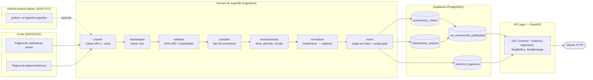

# API pública de dados de segurança — SSPDS/CE

       

## 1. Visão geral

O **api_sspds** coleta, normaliza, armazena e disponibiliza, em JSON, os dados estatísticos de segurança pública publicados pela **Secretaria da Segurança Pública e Defesa Social do Ceará (SSPDS/CE)** em planilhas eletrônicas (`.xlsx`).

Na fonte original, as informações estão espalhadas em dezenas de planilhas que exigem localização, download e interpretação manual. O projeto automatiza esse trabalho para **estudantes, pesquisadores, jornalistas e demais pessoas que precisam consultar ou analisar dados públicos de segurança do Ceará**.

### Principais funcionalidades

- **Coleta automática** dos links das planilhas na página de indicadores atuais e na página de série histórica da SSPDS/CE (raspagem com BeautifulSoup), registrando de qual seção cada arquivo veio.
- **Download seguro** dos arquivos `.xlsx` (gravação atômica em arquivo `.part`) e **validação da pasta temporária** antes de qualquer remoção.
- **Controle de duplicidade** por hash SHA-256: planilhas já publicadas não são reprocessadas.
- **Versionamento resiliente**: as planilhas da SSPDS são cumulativas e renomeadas a cada atualização; o pipeline identifica a versão por `(tipo de crime, série)`, carrega a nova antes de apagar a antiga e bloqueia substituições suspeitas (veja [`docs/ingestion.md`](docs/ingestion.md#4-versionamento-das-planilhas)).
- **Classificação** automática do tipo de ocorrência (CVLI, CVP, furto, entorpecentes etc.) a partir do nome do arquivo.
- **Normalização** dos dados para um schema único, com sinalização (sem correção silenciosa) de inconsistências da fonte, como idade inválida e dia da semana divergente da data.
- **Carga com marca de conclusão**: uma carga só é considerada completa quando `periodo_dados` é preenchido, e falhas desfazem a carga parcial.
- **Persistência** em PostgreSQL hospedado no Supabase, com histórico de cada execução da ingestão (`SUCESSO`, `PARCIAL` ou `FALHA`).
- **Ingestão agendada** diariamente via GitHub Actions.
- **API REST** (FastAPI) com documentação interativa em `/docs`.

### Fonte dos dados, licença e escopo

| Fonte | Órgão | Endereço | Atualização |
| :-- | :-- | :-- | :-- |
| Estatísticas da SSPDS/CE | Secretaria da Segurança Pública e Defesa Social do Ceará | <https://www.ce.gov.br/sspds/estatisticas/> | Mensal; os dados se referem ao mês encerrado (ex.: dados de setembro são publicados em outubro) |

- **Dados:** públicos e abertos, sob o **Decreto Estadual nº 36.746/2025** e a **Lei Federal nº 12.527/2011 (LAI)**, com livre utilização, cruzamento e redistribuição mediante atribuição da fonte oficial à **SSPDS/CE** e à **Superintendência de Pesquisa e Estratégia de Segurança Pública (SUPESP)** (manifestação via e-SIC em `docs/evidencias/licenca.pdf`).
- **Código e material desta equipe:** [Licença MIT](LICENSE).
- **O que o projeto não faz:** não inclui painel visual, não faz previsão de crimes, não faz análise causal, não coleta dados pessoais e não permite consulta direta do usuário ao site da SSPDS/CE.
- **Status:** em desenvolvimento.

> [!NOTE]
> A ingestão depende da disponibilidade e do layout das páginas e planilhas públicas da SSPDS/CE. Se a fonte estiver indisponível, os dados já ingeridos são mantidos e a falha é registrada. Se o layout mudar, o crawler e/ou o normalizador precisam ser ajustados (veja [`docs/ingestion.md`](docs/ingestion.md)).

---

## 2. Arquitetura e fluxo de dados



**Resumo do fluxo**

1. O **crawler** lê as duas páginas da SSPDS/CE e devolve uma lista única de URLs de planilhas (atuais primeiro, depois históricas, sem duplicatas), guardando a série de origem (`corrente` ou `historica`).
2. Para cada URL, o pipeline **baixa** a planilha, calcula o **SHA-256** e consulta os metadados. Se o conteúdo já foi publicado, a planilha é ignorada.
3. Planilhas novas são **classificadas** por tipo, **inspecionadas** (série, período, último mês) e comparadas com a versão anterior da mesma série. Mudanças inesperadas geram aviso e preservam a versão anterior.
4. Se a carga for liberada, o pipeline grava o arquivo em `informacoes_arquivo` com `periodo_dados` nulo, **normaliza** a planilha com `pandas`, insere as ocorrências em `ocorrencias_crimes` em lotes (ligadas ao arquivo pela chave `arquivo_id`) e confere a contagem. Só então **publica** (preenche `periodo_dados`) e exclui a versão substituída.
5. Cada execução é registrada em `historico_ingestoes` (status, contadores, mensagem de erro/avisos, datas).
6. A **API** consulta a view `vw_ocorrencias_publicadas` (somente arquivos já publicados, com `periodo_dados` preenchido) em `app/services/crime_service.py` e a tabela `historico_ingestoes` em `app/services/historico_ingestoes_service.py`, expondo os dados em JSON com filtros por município, tipo de crime, AIS, natureza, perfil da vítima, dia da semana, tipo de entorpecente, período (`data_fato`) e status/data de ingestão.

> [!NOTE]
> A API lê **diretamente do Supabase** (`SUPABASE_URL` e `SUPABASE_KEY` no `.env`). Se não houver registros para a consulta, a rota responde `404`.

---

## 3. Stack tecnológica

| Camada | Ferramentas |
| :-- | :-- |
| Linguagem | Python 3.13 |
| API | FastAPI, Uvicorn, Pydantic |
| Ingestão / ETL | Requests, BeautifulSoup4, Pandas, OpenPyXL |
| Banco de dados | PostgreSQL (Supabase), cliente `supabase-py`, `httpx` |
| Configuração | python-dotenv (arquivo `.env`) |
| Contêineres | Docker e Docker Compose |
| Automação | GitHub Actions (ingestão agendada) |
| Testes | pytest (com `TestClient` do FastAPI) |

As versões exatas estão fixadas em [`requirements.txt`](requirements.txt).

---

## 4. Estrutura do projeto

```text
api_sspds/
├── .github/
│   └── workflows/
│       └── ingestion.yml     # Ingestão agendada (GitHub Actions)
├── app/                      # API FastAPI
│   ├── routers/              #   rotas (crimes.py, historico_ingestoes.py)
│   ├── schemas/              #   modelos Pydantic de resposta
│   ├── services/             #   acesso aos dados (crime_service.py, historico_ingestoes_service.py)
│   ├── config.py             #   get_variavel_ambiente (leitura do .env da API)
│   ├── exception.py          #   handlers de exceção
│   ├── main.py               #   instância FastAPI, /, /health/live, /health/ready
│   └── dockerfile
├── ingestion/                # Serviço de ingestão (ETL)
│   ├── classifier.py  cleanup.py  config.py  crawler.py  downloader.py
│   ├── exception.py   helpers.py  insert.py  normalizer.py
│   ├── pipeline.py    validator.py  versionamento.py
│   └── dockerfile
├── database/                 # Camada de acesso ao Supabase
│   ├── config.py  exceptions.py  repository.py
├── logging_system/           # Configuração de logs compartilhada
│   ├── config.py  exception.py  logging_config.py
├── certs/                    # Certificado CA adicional (ingestão)
├── docs/                     # Documentação
│   ├── api.md  database.md  ingestion.md
│   ├── diario-de-bordo.md  marco-1.md  plano-de-acao.md
│   └── evidencias/  evidencias.csv
├── tests/                    # Testes automatizados (pytest)
│   ├── conftest.py  test_crimes.py  test_database.py
│   ├── test_health.py  test_historico_ingestoes.py
│   └── test_ingestion.py  test_versionamento.py
├── .env.example
├── .gitignore
├── compose.yml
├── LICENSE
├── pytest.ini
├── README.md
└── requirements.txt
```

### Serviços principais (documentação dedicada)

| Diretório | Resumo | Documentação |
| :-- | :-- | :-- |
| `app/` | API FastAPI que disponibiliza os dados em JSON. | [`docs/api.md`](docs/api.md) |
| `ingestion/` | Pipeline de ETL: coleta, valida, versiona, normaliza e carrega as planilhas da SSPDS/CE. | [`docs/ingestion.md`](docs/ingestion.md) |
| `database/` | Modelagem do banco (Supabase/PostgreSQL) e camada de acesso a dados (`repository.py`: consulta com filtros de igualdade, intervalo de datas e limite; inserção; atualização; exclusão; contagem). | [`docs/database.md`](docs/database.md) |

### Demais pastas e arquivos

| Caminho | Responsabilidade |
| :-- | :-- |
| `.github/workflows/ingestion.yml` | Executa `python -m ingestion.pipeline` todo dia às 03:00 UTC (meia-noite em Fortaleza) e sob demanda (`workflow_dispatch`). Serializa execuções com `concurrency` e usa os secrets `SUPABASE_URL` e `SUPABASE_KEY`. Detalhes em [`docs/ingestion.md`](docs/ingestion.md#6-execução-agendada-github-actions). |
| `logging_system/` | Configuração de logs compartilhada por ingestão e banco. `configure_logging()` lê `LOG_LEVEL` e define o formato `data \| nível \| logger \| mensagem`. Também define a exceção de variável de ambiente ausente. |
| `tests/` | Suíte `pytest`. `test_ingestion.py` cobre crawler, helpers, normalizadores, classificador, validador, cleanup e pipeline (com fakes; sem rede). `test_versionamento.py` cobre as regras de série, versão e reconciliação (sem rede). `test_health.py` testa `/health/live` e `/health/ready` (com `monkeypatch`; sem banco). `test_crimes.py` e `test_historico_ingestoes.py` testam as rotas da API com `TestClient` (consultam o Supabase real). `test_database.py` (marcador `database`) testa a camada de acesso ao Supabase em uma instância real. `conftest.py` reúne os fixtures (HTML sintético, DataFrames de exemplo, ambiente fake do pipeline, cliente Supabase). |
| `certs/` | Certificado intermediário **Amazon RSA 2048 M01** (`.crt` e `.der`). O servidor do portal (`www.ce.gov.br`) não envia esse intermediário, e o `requests` em Linux/Docker não o obtém sozinho (erro `CERTIFICATE_VERIFY_FAILED`). O `.crt` é instalado na imagem da ingestão e no workflow do GitHub Actions, com `REQUESTS_CA_BUNDLE` apontando para o conjunto de certificados do sistema, sem `verify=False`. Detalhes em [`docs/ingestion.md`](docs/ingestion.md#75-erro-de-certificado-ssl-certificate_verify_failed). |
| `app/dockerfile` | Imagem da API: `python:3.13.4`, instala `requirements.txt`, copia `app/`, `database/` e `logging_system/` e inicia `uvicorn app.main:app` na porta 8000. |
| `ingestion/dockerfile` | Imagem da ingestão: `python:3.13.4`, instala `requirements.txt`, instala o certificado CA de `certs/`, copia `ingestion/`, `database/` e `logging_system/` e executa `python -m ingestion.pipeline`. |
| `compose.yml` | Orquestra os serviços `api` (porta `8000`, `--reload`, volume `./app`) e `ingestion` (execução única do pipeline, volume `./ingestion`). Ambos usam o `.env` da raiz. |
| `requirements.txt` | Dependências Python com versões fixadas, compartilhadas pelos dois serviços e pelos testes. |
| `pytest.ini` | Configuração do pytest: `testpaths = tests`, opções `-v --color=yes --tb=short` e os marcadores `database` e `integration`. |
| `.env.example` | Modelo do arquivo `.env` (veja a [seção 5](#5-pré-requisitos-e-configuração-do-ambiente)). |
| `.gitignore` | Ignora `.env`, `.venv`, `__pycache__`, `dados.json`, `tiposOcorrencias.json`, `.pytest_cache`, `tempfiles` e `supabase`. |
| `docs/diario-de-bordo.md`, `docs/marco-1.md`, `docs/plano-de-acao.md` | Registros do processo de desenvolvimento: diário semanal, entrega do Marco 1 e plano de ação do projeto. |
| `docs/evidencias/`, `docs/evidencias.csv` | Evidências de divulgação, testes com público externo, licença dos dados e comunicação com a SSPDS (PDFs) e o índice delas em CSV. |
| `LICENSE` | Licença MIT do código. |

### 4.1 Camada de acesso ao banco (`database/`)

O pacote `database/` fornece funções utilitárias compartilhadas entre os serviços para interagir com o PostgreSQL/Supabase:

- `criar_cliente_supabase()`: cria o cliente (timeout de 10 s).
- `validar_conexao(cliente)`: valida a conectividade ativa com a base de dados.
- `consultar_registros(tabela, filtros, limite, coluna_data, data_inicio, data_fim, colunas)`: executa consultas `SELECT` com filtros de igualdade, **intervalo de datas** (`gte`/`lte`) e limite.
- `inserir_registros(tabela, dados)`: insere registros individuais ou em lote.
- `atualizar_registro(tabela, id_registro, novos_dados)`: atualiza campos de uma linha específica.
- `excluir_arquivo(id_arquivo)`: exclui um registro de `informacoes_arquivo`; o `ON DELETE CASCADE` remove as ocorrências vinculadas.
- `contar_ocorrencias_por_arquivo(arquivo_id)`: contagem exata de ocorrências de um arquivo.

Exemplo de consulta por período e município:

```python
from database.repository import consultar_registros

ocorrencias = consultar_registros(
    tabela="ocorrencias_crimes",
    filtros={"tipo_crime": "CRIMES VIOLENTOS LETAIS E INTENCIONAIS - CVLI", "municipio": "Fortaleza"},
    coluna_data="data_fato",
    data_inicio="2026-08-01",
    data_fim="2026-08-31",
    limite=50
)
```

---

## 5. Pré-requisitos e configuração do ambiente

### Pré-requisitos

| Ferramenta | Versão / observação |
| :-- | :-- |
| Python | 3.13 (as imagens Docker usam `python:3.13.4`) |
| Git | qualquer versão recente |
| Docker + Docker Compose v2 | necessário apenas para a execução via contêineres (no Windows, requer WSL2 e virtualização habilitada) |
| Projeto no Supabase | URL e chave de serviço (`service_role`); schema criado com o DDL de [`docs/database.md`](docs/database.md#6-script-ddl-completo-reprodução-do-schema) |
| Acesso à internet | para acessar o portal da SSPDS/CE e o Supabase |

> [!IMPORTANT]
> Os módulos de ingestão leem variáveis de ambiente **no momento do `import`**. Sem o `.env` preenchido, o pipeline **e também os testes** falham logo ao iniciar com `VariavelAmbienteNaoEncontrada`.

### Variáveis de ambiente

Copie o modelo e preencha:

```bash
cp .env.example .env        # Windows (PowerShell): Copy-Item .env.example .env
```

| Variável | Descrição | Exemplo / padrão | Obrigatória |
| :-- | :-- | :-- | :-- |
| `url_sspds` | URL da página de estatísticas **atuais** da SSPDS/CE (ingestão). | `https://www.ce.gov.br/sspds/estatisticas/` | Sim (ingestão) |
| `url_sspds_historico` | URL da página de **dados históricos** (ingestão). | `https://www.ce.gov.br/sspds/estatisticas/dados-detalhados/` | Sim (ingestão) |
| `CRAWLER_TIMEOUT` | Timeout, em segundos, das requisições do crawler. Se ausente ou inválida, usa 10 s e registra um aviso. | `10` | Não |
| `DOWNLOADER_TIMEOUT` | Timeout, em segundos, do download das planilhas (inteiro). | `30` | Sim (ingestão) |
| `TEMP_PATH` | Pasta temporária dos downloads, **subpasta do diretório de execução** (`.`, `/`, ancestrais e a pasta `ingestion/` são rejeitados); é apagada ao final do pipeline. | `ingestion/tempfiles` | Sim (ingestão) |
| `CHUNK_SIZE` | Tamanho, em bytes, dos blocos de download. Aceita aritmética simples (`+`, `-`, `*`, `//`, parênteses), avaliada por um parser seguro (sem `eval`). | `1024 * 64` | Sim (ingestão) |
| `HASH_CHUNK_SIZE` | Tamanho, em bytes, dos blocos de leitura no cálculo do SHA-256. Aceita aritmética simples, como `CHUNK_SIZE`. | `1024 * 1024` | Sim (ingestão) |
| `INSERT_CHUNK_SIZE` | Quantidade de registros por lote na inserção em `ocorrencias_crimes` (inteiro simples). | `300` | Sim (ingestão) |
| `LOG_LEVEL` | Nível de log (`DEBUG`, `INFO`, `WARNING`, `ERROR`…). Valor inválido cai para `INFO`; a variável ausente gera erro. | `INFO` | Sim (API, ingestão, banco e testes) |
| `SUPABASE_URL` | URL do projeto Supabase. | `https://<projeto>.supabase.co` | Sim (API, ingestão e testes de banco) |
| `SUPABASE_KEY` | Chave de acesso ao Supabase (a camada de acesso foi desenhada para a `service_role`; veja [`docs/database.md`](docs/database.md)). **Nunca versione.** | — | Sim (API, ingestão e testes de banco) |

> [!CAUTION]
> `.env` contém credenciais e já está no `.gitignore`. Não o publique.

---

## 6. Como executar o projeto

### 6.1 Clonar o repositório

```bash
git clone https://github.com/lucaspbds/api_sspds.git
cd api_sspds
cp .env.example .env     # depois edite o .env (principalmente SUPABASE_URL e SUPABASE_KEY)
```

### 6.2 Via Docker Compose

```bash
# Sobe API e ingestão juntas (build + execução)
docker compose up --build
```

Ou serviço a serviço:

```bash
# API em http://localhost:8000
docker compose build api
docker compose up api

# Ingestão (execução única: o container encerra ao final do pipeline)
docker compose build ingestion
docker compose up ingestion      # ou: docker compose run --rm ingestion
```

Para encerrar: `Ctrl + C`, depois `docker compose down`. Para listar serviços ativos: `docker compose ps`.

### 6.3 Localmente (sem Docker)

```bash
# 1. Ambiente virtual
python -m venv .venv
source .venv/bin/activate            # Linux / macOS
.venv\Scripts\Activate.ps1           # Windows (PowerShell)

# 2. Dependências
pip install -r requirements.txt

# 3. Pipeline de ingestão (sempre a partir da raiz do repositório)
python -m ingestion.pipeline

# 4. API
uvicorn app.main:app --reload --port 8000
```

> [!NOTE]
> Execute a ingestão com `python -m ingestion.pipeline` (como no `compose.yml`, no `dockerfile` e no workflow). Rodar `python ingestion/pipeline.py` quebra os imports relativos do pacote. O processo termina com código `0` se nenhum arquivo falhou e `1` caso contrário.

> [!WARNING]
> Não execute duas ingestões ao mesmo tempo contra o mesmo banco: a limpeza de cargas incompletas pressupõe uma única execução ativa.

### 6.4 Ingestão agendada (GitHub Actions)

O workflow [`ingestion.yml`](.github/workflows/ingestion.yml) roda a ingestão diariamente às 03:00 UTC e pode ser disparado manualmente em **Actions → Ingestão SSPDS → Run workflow**. Para usá-lo em um fork ou repositório novo, cadastre os secrets `SUPABASE_URL` e `SUPABASE_KEY` em *Settings → Secrets and variables → Actions*. As demais variáveis já estão definidas no próprio workflow.

### 6.5 Verificar a API

| Endereço | O que retorna |
| :-- | :-- |
| `http://localhost:8000/` | Mensagem de boas-vindas e atalho para `/docs`. |
| `http://localhost:8000/health/live` | Liveness check: `{"status": "ok"}`. |
| `http://localhost:8000/health/ready` | Readiness check (valida conexão com o Supabase): `{"status": "ready", "database": "ok"}` ou `503`. |
| `http://localhost:8000/docs` | Documentação interativa (Swagger UI). |
| `http://localhost:8000/redoc` | Visualização alternativa da documentação, boa para leitura detalhada dos contratos de resposta e schemas. |
| `http://localhost:8000/crimes/cvli?limit=5` | Primeiras 5 ocorrências de CVLI. |
| `http://localhost:8000/crimes/?municipio=Fortaleza&tipo_crime=FURTO&data_inicio=2025-01-01&data_fim=2025-03-31&limit=10` | Consulta geral com filtros combinados (município, tipo de crime e período). |
| `http://localhost:8000/crimes/vitimas`, `/crimes/preconceito`, `/crimes/operacionais` | Demais rotas específicas de ocorrências (veja [`docs/api.md`](docs/api.md)). |
| `http://localhost:8000/historico-ingestoes/?limit=5` | Histórico das execuções da ingestão (aceita filtros por `status`, `data` e `limit`). |

Detalhes de parâmetros, schemas e códigos de resposta (`200`, `404`, `422`, `500`, `503`) em [`docs/api.md`](docs/api.md).

### 6.6 Executar os testes

Com o ambiente virtual ativo e o `.env` preenchido, a partir da raiz:

```bash
# Suíte completa
python -m pytest

# Somente testes de ingestão e versionamento (fakes/mocks; sem rede e sem banco)
python -m pytest tests/test_ingestion.py tests/test_versionamento.py

# Tudo, exceto os testes marcados como `database`
python -m pytest -m "not database"
```

| Arquivo | Pré-requisito |
| :-- | :-- |
| `tests/test_ingestion.py` | `.env` preenchido (as configurações são lidas no import). Não acessa rede nem banco. |
| `tests/test_versionamento.py` | Não acessa rede nem banco. |
| `tests/test_health.py` | `.env` preenchido (módulos de log/banco lidos no import). Não acessa rede nem banco (usa `monkeypatch`). |
| `tests/test_crimes.py` | `SUPABASE_URL` e `SUPABASE_KEY` válidos e ao menos um registro publicado de CVLI em `vw_ocorrencias_publicadas` (senão a rota responde `404` e os testes de sucesso falham). **Não** tem o marcador `database`, então `-m "not database"` não o exclui. |
| `tests/test_historico_ingestoes.py` | `SUPABASE_URL` e `SUPABASE_KEY` válidos e ao menos um registro em `historico_ingestoes` para o teste sem filtros retornar `200`. **Não** tem o marcador `database`. |
| `tests/test_database.py` | `SUPABASE_URL` e `SUPABASE_KEY` válidos; executa leituras **e escritas** (inserções, atualizações e exclusões) — use uma instância de desenvolvimento. Exige que o schema tenha `serie`, `ultimo_mes`, o status `PARCIAL` e a view `vw_ocorrencias_publicadas`. |

---

## 7. Documentação detalhada

| Documento | Conteúdo |
| :-- | :-- |
| [`docs/api.md`](docs/api.md) | Estrutura da API, endpoints, parâmetros e códigos de resposta. |
| [`docs/ingestion.md`](docs/ingestion.md) | Pipeline de ingestão: módulos, versionamento, regras de validação/normalização, operação, GitHub Actions, erros, testes e limitações conhecidas. |
| [`docs/database.md`](docs/database.md) | Modelo de dados, dicionário de dados, DDL completo, view de publicação e camada de acesso ao Supabase. |

---

## Contato

davidlucas2610@gmail.com · nikellysantiago@alu.ufc.br · Abimael.oliveira@alu.ufc.br
