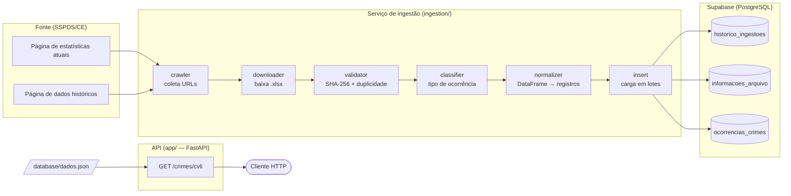

# API pública de dados de segurança — SSPDS/CE

      

## 1. Visão geral

O **api_sspds** coleta, normaliza, armazena e disponibiliza, em JSON, os dados estatísticos de segurança pública publicados pela **Secretaria da Segurança Pública e Defesa Social do Ceará (SSPDS/CE)** em planilhas eletrônicas (`.xlsx`).

Na fonte original, as informações estão espalhadas em dezenas de planilhas que exigem localização, download e interpretação manual. O projeto automatiza esse trabalho para **estudantes, pesquisadores, jornalistas e demais pessoas que precisam consultar ou analisar dados públicos de segurança do Ceará**.

### Principais funcionalidades

- **Coleta automática** dos links das planilhas na página de indicadores atuais e na página de série histórica da SSPDS/CE (raspagem com BeautifulSoup).
- **Download seguro** dos arquivos `.xlsx` (gravação atômica em arquivo `.part`).
- **Controle de duplicidade** por hash SHA-256 e por nome de arquivo: planilhas já ingeridas não são reprocessadas.
- **Classificação** automática do tipo de ocorrência (CVLI, CVP, furto, entorpecentes etc.) a partir do nome do arquivo.
- **Normalização** dos dados para um schema único, com sinalização (sem correção silenciosa) de inconsistências da fonte, como idade inválida e dia da semana divergente da data.
- **Persistência** em PostgreSQL hospedado no Supabase, com histórico de cada execução da ingestão.
- **API REST** (FastAPI) com documentação interativa em `/docs`.

### Fonte dos dados, licença e escopo

| Fonte | Órgão | Endereço | Atualização |
| :-- | :-- | :-- | :-- |
| Estatísticas da SSPDS/CE | Secretaria da Segurança Pública e Defesa Social do Ceará | <https://www.ce.gov.br/sspds/estatisticas/> | Mensal; os dados se referem ao mês encerrado (ex.: dados de setembro são publicados em outubro) |

- **Dados:** públicos e abertos, sob o **Decreto Estadual nº 36.746/2025** e a **Lei Federal nº 12.527/2011 (LAI)**, com livre utilização, cruzamento e redistribuição mediante atribuição da fonte oficial à **SSPDS/CE** e à **Superintendência de Pesquisa e Estratégia de Segurança Pública (SUPESP)** (manifestação via e-SIC em `docs/evidencias/licenca.pdf`).
- **Código e material desta equipe:** [Licença MIT](LICENSE).
- **O que o projeto não faz:** não inclui painel visual, não faz previsão de crimes, não faz análise causal, não coleta dados pessoais e não permite consulta direta do usuário ao site da SSPDS/CE.
- **Status:** em desenvolvimento.

> [!NOTE]
> A ingestão depende da disponibilidade e do layout das páginas e planilhas públicas da SSPDS/CE. Se a fonte estiver indisponível, os dados já ingeridos são mantidos e a falha é registrada. Se o layout mudar, o crawler e/ou o normalizador precisam ser ajustados (veja [`docs/ingestion.md`](docs/ingestion.md)).

---

## 2. Arquitetura e fluxo de dados



**Resumo do fluxo**

1. O **crawler** lê as duas páginas da SSPDS/CE e devolve uma lista única de URLs de planilhas (atuais primeiro, depois históricas, sem duplicatas).
2. Para cada URL, o pipeline **baixa** a planilha, calcula o **SHA-256** e consulta o banco. Se o conteúdo já foi ingerido, a planilha é ignorada.
3. Planilhas novas são **classificadas**, têm seus metadados gravados em `informacoes_arquivo`, são lidas com `pandas`, **normalizadas** e inseridas em `ocorrencias_crimes` em lotes, ligadas ao arquivo de origem pela chave estrangeira `arquivo_id`.
4. Cada execução é registrada em `historico_ingestoes` (status, contadores, datas).
5. A **API** expõe os dados em JSON.

> [!WARNING]
> **Estado atual da API:** a rota `GET /crimes/cvli` lê o arquivo local `database/dados.json` (ignorado pelo Git; pasta configurável por `DATABASE_PATH`), e **nenhum módulo do pipeline atual gera esse arquivo** — a ingestão grava no Supabase. Sem o arquivo, a rota responde `404`.
> `TODO`: migrar `app/services/crime_service.py` para consultar o Supabase.

---

## 3. Stack tecnológica

| Camada | Ferramentas |
| :-- | :-- |
| Linguagem | Python 3.13 |
| API | FastAPI, Uvicorn, Pydantic |
| Ingestão / ETL | Requests, BeautifulSoup4, Pandas, OpenPyXL |
| Banco de dados | PostgreSQL (Supabase), cliente `supabase-py`, `httpx` |
| Configuração | python-dotenv (arquivo `.env`) |
| Contêineres | Docker e Docker Compose |
| Testes | pytest (com `TestClient` do FastAPI) |

2. **Configuração de Variáveis de Ambiente (`.env`):**
Crie um arquivo `.env` na raiz do projeto com as configurações gerais do serviço:
```env
# Configurações do serviço de ingestão de dados
url_sspds="https://www.ce.gov.br/sspds/estatisticas/"
```
Observação: Utilize o arquivo `.env.example`.

---
### Via Docker
####  Execução Individual dos Serviços

##### A. Serviço de API

A API é responsável por disponibilizar os dados processados via endpoints.
###### Execução via Docker (Individual)
```bash
# Construir a imagem Docker
docker compose build api

# Rodar o container da API 
docker compose up api
```

---
##### B. Serviço de Ingestão (Ingestion)

O serviço de ingestão executa a coleta, transforma os dados em json e salva na pasta `database`.
###### Execução via Docker (Individual)
```bash
# Criar a imagem do serviço de Ingestion
docker compose build ingestion

#Rodar o container
docker compose up ingestion
```

---
#### 🔗 Execução Conjunta via Docker Compose

1. **Subir todos os serviços:**
   ```bash
   docker compose up --build
   ```

---
#### 🛠️ Parar Serviços Docker

1. Aperte `Ctrl + C` para finalizar os processos docker
2. Verifique se ainda tem algum serviço rodando:
	- Rode o comando `docker compose ps` para listar todos os serviços que estão rodando no momento. Caso tenha, rode `docker compose down` para finalizar. 

---
### 💻 Execução Local (Sem Docker)

Caso prefira rodar a aplicação diretamente no seu ambiente Python:

1. **Criar e ativar o ambiente virtual:**
```bash
   # Windows (PowerShell)
   python -m venv .venv
   .venv\Scripts\Activate.ps1

   # Linux / macOS
   python3 -m venv .venv
   source .venv/bin/activate
```

2. **Instalar as dependências:**
```bash
pip install -r requirements.txt
```

3. **Executar a Ingestão de Dados:**
```bash
python ingestion/pipeline.py
```
   *(Os dados processados serão salvos na pasta database/dados.json).*

4. **Executar a API:**
```bash
uvicorn app.main:app --reload
```

---
### 🧪 Verificação da Aplicação

Com a API rodando, você pode acessar as interfaces de documentação interativa para testar os endpoints:

1. **Documentação Interativa (Swagger UI) — *A principal***
   * **Link:** `http://localhost:8000/docs`
   * **Para que serve:** Interface visual completa onde você consegue visualizar todas as rotas (`/crimes/`, `/crimes/cvli`, `/crimes/vitimas`, `/crimes/preconceito`, `/crimes/operacionais`), testar os parâmetros de filtro em tempo real clicando em **"Try it out"** e verificar os payloads de resposta em JSON.

2. **Documentação Alternativa (ReDoc)**
   * **Link:** `http://localhost:8000/redoc`
   * **Para que serve:** Uma opção alternativa de visualização estruturada da documentação, excelente para leitura detalhada dos contratos de resposta e schemas de dados.

- **Status da Ingestão:** Retornará no terminal a quantidade de URLs coletadas e os dados salvos em `database/dados.json`.

---

## 4. Estrutura do projeto

```text
api_sspds/
├── app/                      # API FastAPI
│   ├── routers/              #   rotas (crimes.py)
│   ├── schemas/              #   modelos Pydantic de resposta
│   ├── services/             #   regras de acesso aos dados (crime_service.py)
│   ├── config.py
│   ├── exception.py          #   handlers de exceção
│   ├── main.py               #   instância FastAPI, /, /health
│   └── dockerfile
├── ingestion/                # Serviço de ingestão (ETL)
│   ├── classifier.py  cleanup.py  config.py  crawler.py  downloader.py
│   ├── exception.py   helpers.py  insert.py  normalizer.py
│   ├── pipeline.py    validator.py
│   └── dockerfile
├── database/                 # Camada de acesso ao Supabase
│   ├── config.py  exceptions.py  repository.py
├── logging_system/           # Configuração de logs compartilhada
│   ├── config.py  exception.py  logging_config.py
├── certs/                    # Certificado CA adicional (container de ingestão)
├── docs/                     # Documentação
│   ├── api.md  database.md  ingestion.md
│   ├── diario-de-bordo.md  marco-1.md  plano-de-acao.md
│   └── evidencias/  evidencias.csv
├── tests/                    # Testes automatizados (pytest)
│   ├── conftest.py  test_crimes.py  test_database.py  test_ingestion.py
├── .env.example
├── .gitignore
├── compose.yml
├── LICENSE
├── pytest.ini
├── README.md
└── requirements.txt
```

### Serviços principais (documentação dedicada)

| Diretório | Resumo | Documentação |
| :-- | :-- | :-- |
| `app/` | API FastAPI que disponibiliza os dados em JSON. | [`docs/api.md`](docs/api.md) |
| `ingestion/` | Pipeline de ETL: coleta, valida, normaliza e carrega as planilhas da SSPDS/CE. | [`docs/ingestion.md`](docs/ingestion.md) |
| `database/` | Modelagem do banco (Supabase/PostgreSQL) e camada de acesso a dados. | [`docs/database.md`](docs/database.md) |

### Demais pastas e arquivos

| Caminho | Responsabilidade |
| :-- | :-- |
| `logging_system/` | Configuração de logs compartilhada por ingestão e banco. `configure_logging()` lê `LOG_LEVEL` e define o formato `data \| nível \| logger \| mensagem`. Também define a exceção de variável de ambiente ausente. |
| `tests/` | Suíte `pytest`. `test_ingestion.py` cobre crawler, helpers, normalizadores, classificador e validador (com mocks; sem rede). `test_crimes.py` testa a rota da API com `TestClient`. `test_database.py` (marcador `database`) testa a camada de acesso ao Supabase em uma instância real. `conftest.py` reúne os fixtures (HTML sintético, DataFrames de exemplo, cliente Supabase). |
| `certs/` | Certificado intermediário **Amazon RSA 2048 M01** (`.crt` e `.der`). O servidor do portal (`www.ce.gov.br`) não envia esse intermediário na cadeia, e o `requests` em Linux/Docker não o obtém sozinho (erro `CERTIFICATE_VERIFY_FAILED`). O `.crt` é instalado na imagem da ingestão e `REQUESTS_CA_BUNDLE` aponta para o conjunto de certificados do sistema, sem usar `verify=False`. Detalhes em [`docs/ingestion.md`](docs/ingestion.md#55-erro-de-certificado-ssl-certificate_verify_failed). |
| `app/dockerfile` | Imagem da API: `python:3.13.4`, instala `requirements.txt`, copia `app/`, `database/` e `logging_system/` e inicia `uvicorn app.main:app` na porta 8000. |
| `ingestion/dockerfile` | Imagem da ingestão: `python:3.13.4`, instala `requirements.txt`, instala o certificado CA de `certs/`, copia `ingestion/`, `database/` e `logging_system/` e executa `python -m ingestion.pipeline`. |
| `compose.yml` | Orquestra os serviços `api` (porta `8000`, `--reload`, volume `./app`) e `ingestion` (execução única do pipeline, volume `./ingestion`). Ambos usam o `.env` da raiz. |
| `requirements.txt` | Dependências Python com versões fixadas, compartilhadas pelos dois serviços e pelos testes. |
| `pytest.ini` | Configuração do pytest: `testpaths = tests`, opções `-v --color=yes --tb=short` e os marcadores `database` e `integration`. |
| `.env.example` | Modelo do arquivo `.env` (veja a [seção 5](#5-pré-requisitos-e-configuração-do-ambiente)). |
| `.gitignore` | Ignora `.env`, `.venv`, `__pycache__`, `dados.json`, `tiposOcorrencias.json`, `.pytest_cache`, `tempfiles` e `supabase`. |
| `docs/diario-de-bordo.md`, `docs/marco-1.md`, `docs/plano-de-acao.md` | Registros do processo de desenvolvimento: diário semanal, entrega do Marco 1 e plano de ação do projeto. |
| `docs/evidencias/`, `docs/evidencias.csv` | Evidências de divulgação, testes com público externo e licença dos dados (PDFs) e o índice delas em CSV. |
| `LICENSE` | Licença MIT do código. |

> `TODO`: `app/config.py` importa `from exception import ...` (sem o prefixo `app.`) e não é usado por `app/main.py`; revisar se o módulo ainda é necessário.

---

## 5. Pré-requisitos e configuração do ambiente

### Pré-requisitos

| Ferramenta | Versão / observação |
| :-- | :-- |
| Python | 3.13 (as imagens Docker usam `python:3.13.4`) |
| Git | qualquer versão recente |
| Docker + Docker Compose v2 | necessário apenas para a execução via contêineres (no Windows, requer WSL2 e virtualização habilitada) |
| Projeto no Supabase | URL e chave de serviço (`service_role`); schema criado com o DDL de [`docs/database.md`](docs/database.md#6-script-ddl-completo-reprodução-do-schema) |
| Acesso à internet | para acessar o portal da SSPDS/CE e o Supabase |

> [!IMPORTANT]
> Os módulos de ingestão leem variáveis de ambiente **no momento do `import`**. Sem o `.env` preenchido, o pipeline **e também os testes** falham logo ao iniciar com `VariavelAmbienteNaoEncontrada`.

### Variáveis de ambiente

Copie o modelo e preencha:

```bash
cp .env.example .env        # Windows (PowerShell): Copy-Item .env.example .env
```

| Variável | Descrição | Exemplo / padrão | Obrigatória |
| :-- | :-- | :-- | :-- |
| `url_sspds` | URL da página de estatísticas **atuais** da SSPDS/CE (ingestão). | `https://www.ce.gov.br/sspds/estatisticas/` | Sim (ingestão) |
| `url_sspds_historico` | URL da página de **dados históricos** (ingestão). | `https://www.ce.gov.br/sspds/estatisticas/dados-detalhados/` | Sim (ingestão) |
| `CRAWLER_TIMEOUT` | Timeout, em segundos, das requisições do crawler. Se ausente ou inválida, usa 10 s e registra um aviso. | `10` | Não |
| `DOWNLOADER_TIMEOUT` | Timeout, em segundos, do download das planilhas. | `30` | Sim (ingestão) |
| `TEMP_PATH` | Pasta temporária dos downloads, **relativa ao diretório de execução**; é apagada ao final do pipeline. | `ingestion/tempfiles` | Sim (ingestão) |
| `CHUNK_SIZE` | Tamanho, em bytes, dos blocos de download. Aceita expressão aritmética (avaliada com `eval`). | `1024 * 64` | Sim (ingestão) |
| `HASH_CHUNK_SIZE` | Tamanho, em bytes, dos blocos de leitura no cálculo do SHA-256. Aceita expressão aritmética. | `1024 * 1024` | Sim (ingestão) |
| `INSERT_CHUNK_SIZE` | Quantidade de registros por lote na inserção em `ocorrencias_crimes`. | `300` | Sim (ingestão) |
| `LOG_LEVEL` | Nível de log (`DEBUG`, `INFO`, `WARNING`, `ERROR`…). Valor inválido cai para `INFO`; a variável ausente gera erro. | `INFO` | Sim (ingestão, banco e testes) |
| `SUPABASE_URL` | URL do projeto Supabase. | `https://<projeto>.supabase.co` | Sim (ingestão e testes de banco) |
| `SUPABASE_KEY` | Chave de acesso ao Supabase (a camada de acesso foi desenhada para a `service_role`; veja [`docs/database.md`](docs/database.md)). **Nunca versione.** | — | Sim (ingestão e testes de banco) |
| `DATABASE_PATH` | Pasta onde a API procura `dados.json`. Não consta no `.env.example`. | `database` (padrão do código) | Não |

> [!CAUTION]
> `.env` contém credenciais e já está no `.gitignore`. Não o publique.

---

## 6. Como executar o projeto

### 6.1 Clonar o repositório

```bash
git clone https://github.com/lucaspbds/api_sspds.git
cd api_sspds
cp .env.example .env     # depois edite o .env (principalmente SUPABASE_URL e SUPABASE_KEY)
```

### 6.2 Via Docker Compose

```bash
# Sobe API e ingestão juntas (build + execução)
docker compose up --build
```

Ou serviço a serviço:

```bash
# API em http://localhost:8000
docker compose build api
docker compose up api

# Ingestão (execução única: o container encerra ao final do pipeline)
docker compose build ingestion
docker compose up ingestion      # ou: docker compose run --rm ingestion
```

Para encerrar: `Ctrl + C`, depois `docker compose down`. Para listar serviços ativos: `docker compose ps`.

### 6.3 Localmente (sem Docker)

```bash
# 1. Ambiente virtual
python -m venv .venv
source .venv/bin/activate            # Linux / macOS
.venv\Scripts\Activate.ps1           # Windows (PowerShell)

# 2. Dependências
pip install -r requirements.txt

# 3. Pipeline de ingestão (sempre a partir da raiz do repositório)
python -m ingestion.pipeline

# 4. API
uvicorn app.main:app --reload --port 8000
```

> [!NOTE]
> Execute a ingestão com `python -m ingestion.pipeline` (como no `compose.yml` e no `dockerfile`). Rodar `python ingestion/pipeline.py` quebra os imports relativos do pacote.

### 6.4 Verificar a API

| Endereço | O que retorna |
| :-- | :-- |
| `http://localhost:8000/` | Mensagem de boas-vindas e atalho para `/docs`. |
| `http://localhost:8000/health` | `{"status": "ok"}` |
| `http://localhost:8000/docs` | Documentação interativa (Swagger UI). |
| `http://localhost:8000/crimes/cvli?limit=5` | Primeiras 5 ocorrências de CVLI (veja o aviso da [seção 2](#2-arquitetura-e-fluxo-de-dados) sobre `dados.json`). |

Detalhes de parâmetros, schemas e códigos de resposta (`200`, `404`, `422`) em [`docs/api.md`](docs/api.md).

### 6.5 Executar os testes

Com o ambiente virtual ativo e o `.env` preenchido, a partir da raiz:

```bash
# Suíte completa
python -m pytest

# Somente testes de ingestão (mocks; sem rede e sem banco)
python -m pytest tests/test_ingestion.py

# Tudo, exceto os testes que usam o Supabase real
python -m pytest -m "not database"
```

| Arquivo | Pré-requisito |
| :-- | :-- |
| `tests/test_ingestion.py` | `.env` preenchido (as configurações são lidas no import). |
| `tests/test_crimes.py` | `database/dados.json` existente (senão a rota responde `404` e os testes de sucesso falham). |
| `tests/test_database.py` | `SUPABASE_URL` e `SUPABASE_KEY` válidos; executam leituras **e escritas** em tabelas como `historico_ingestoes` e `api_request_logs` — use uma instância de desenvolvimento. |

---

## 7. Documentação detalhada

| Documento | Conteúdo |
| :-- | :-- |
| [`docs/api.md`](docs/api.md) | Estrutura da API, endpoints, parâmetros e códigos de resposta. |
| [`docs/ingestion.md`](docs/ingestion.md) | Pipeline de ingestão: módulos, regras de validação/normalização, operação, erros e testes. |
| [`docs/database.md`](docs/database.md) | Modelo de dados, dicionário de dados, DDL completo e camada de acesso ao Supabase. |

---

## Contato

davidlucas2610@gmail.com · nikellysantiago@alu.ufc.br · Abimael.oliveira@alu.ufc.br
