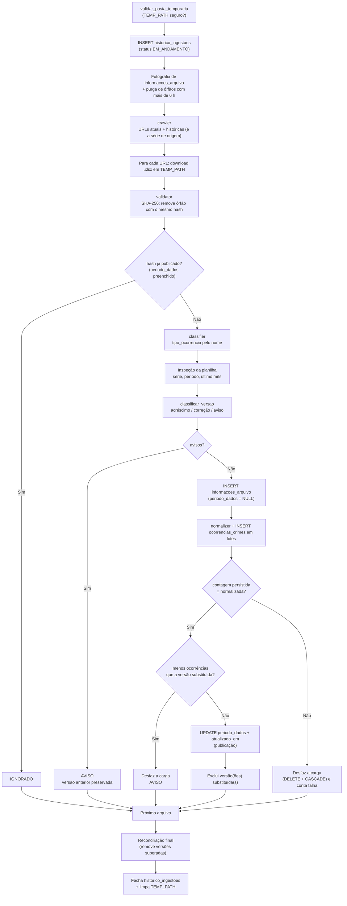

# Serviço de Ingestão de Dados

Documentação técnica do pipeline de ETL do **api_sspds**, responsável por coletar, validar, versionar, normalizar e carregar no banco as planilhas de estatísticas da SSPDS/CE.

- Código: pasta [`ingestion/`](../ingestion/)
- Visão geral do projeto: [`README.md`](../README.md)
- Modelo de dados e camada de acesso ao banco: [`docs/database.md`](database.md)
- Execução agendada: [`.github/workflows/ingestion.yml`](../.github/workflows/ingestion.yml)

---

## 1. Visão geral do pipeline

O serviço de ingestão é o único componente que **escreve** os dados de ocorrências no banco (Supabase/PostgreSQL). Ele transforma as planilhas `.xlsx` publicadas no portal da SSPDS/CE em registros estruturados na tabela `ocorrencias_crimes`, mantendo rastreabilidade do arquivo de origem (`informacoes_arquivo`) e da execução que o trouxe (`historico_ingestoes`).

Dois fatos sobre a fonte guiam todo o desenho:

- A SSPDS publica **26 arquivos**: 13 tipos de crime × (série corrente do ano + série histórica).
- As planilhas são **cumulativas** e **renomeadas** a cada atualização (ex.: `CVLI_Outubro.xlsx` → `CVLI_Novembro.xlsx`; na virada do ano, `CVLI_2009-a-2025.xlsx` → `CVLI_2009-a-2026.xlsx`). Por isso o nome do arquivo não identifica a versão: a identidade lógica é `(tipo_crime, serie)` (veja a [seção 4](#4-versionamento-das-planilhas)).

### Fluxo de ponta a ponta



Resumo das etapas: **Extração** (crawler + downloader) → **Validação** (validator + classifier) → **Versionamento** (inspeção + `versionamento`) → **Normalização** (normalizer) → **Carga** (insert, com publicação ao final).

---

## 2. Arquitetura e módulos do serviço

```text
ingestion/
├── classifier.py     # Classificação do tipo de ocorrência pelo nome do arquivo
├── cleanup.py        # Validação e limpeza da pasta temporária
├── config.py         # Leitura de variáveis de ambiente (get_variavel_ambiente)
├── crawler.py        # Coleta dos links das planilhas e da série de origem
├── downloader.py     # Download dos arquivos .xlsx
├── exception.py      # Hierarquia de exceções do serviço
├── helpers.py        # recebeInteiro e avaliar_expressao_inteira
├── insert.py         # Inserções/atualizações/exclusões nas tabelas do pipeline
├── normalizer.py     # Normalização das planilhas para o schema do banco
├── pipeline.py       # Orquestrador (ponto de entrada)
├── validator.py      # Hash SHA-256 e verificação de duplicidade
├── versionamento.py  # Série, período, classificação de versão e reconciliação
└── dockerfile        # Imagem Docker do serviço
```

Dependências externas ao pacote: `database/repository.py` (acesso ao Supabase) e `logging_system/logging_config.py` (logs). Ambos são copiados para a imagem Docker da ingestão.

### Resumo de entradas e saídas

| Módulo | Entrada | Saída |
| :-- | :-- | :-- |
| `crawler` | variáveis `url_sspds`, `url_sspds_historico`, `CRAWLER_TIMEOUT` | `list[str]` de URLs absolutas, sem duplicatas (e `ORIGEM_POR_URL` preenchido) |
| `downloader` | URL de um `.xlsx` | `Path` relativo do arquivo salvo em `TEMP_PATH` |
| `validator` | caminho do `.xlsx` (+ fotografia dos metadados) | `ValidatedFile` (`dict`) com hash, tamanho e flags |
| `classifier` | `ValidatedFile` | cópia do dict com `tipo_ocorrencia` |
| `versionamento` | metadados da nova versão + fotografia | classificação (`acrescimo`/`correcao`), `ids_substituir`, `avisos` |
| `normalizer` | `DataFrame`, `arquivo_id`, `tipo_ocorrencia` | `list[dict]` pronta para `ocorrencias_crimes` |
| `insert` | dicts / listas | ids, contagens (insere em lotes de `INSERT_CHUNK_SIZE`) |
| `cleanup` | `TEMP_PATH` | — (remove arquivos/pasta) |

### 2.1 `config.py` e `helpers.py`

- `get_variavel_ambiente(nome) -> str`: carrega o `.env` (python-dotenv) e devolve o valor. Lança `VariavelAmbienteNaoEncontrada` se a variável não existir ou estiver vazia.
- `recebeInteiro(valor) -> int`: converte para inteiro; lança `ValorInteiroInvalido` em `ValueError`/`TypeError`. Usada em `DOWNLOADER_TIMEOUT`, `CRAWLER_TIMEOUT` e `INSERT_CHUNK_SIZE` (valores inteiros simples).
- `avaliar_expressao_inteira(expressao) -> int`: usada em `CHUNK_SIZE` e `HASH_CHUNK_SIZE`. Aceita aritmética simples (`"1024 * 64"`), mas **não usa `eval`**: interpreta a expressão via `ast` e só permite inteiros, `+`, `-`, `*`, `//`, sinal unário e parênteses. Potência, divisão `/`, nomes, chamadas de função, `float` e `bool` são rejeitados; o resultado absoluto é limitado a `10**12`. Qualquer violação, divisão por zero ou texto vazio → `ValorInteiroInvalido`.

### 2.2 `crawler.py` — coleta dos links

Acessa duas páginas da SSPDS/CE e extrai os links das planilhas.

| Função | Descrição |
| :-- | :-- |
| `obter_conteudo_html(url, timeout) -> BeautifulSoup` | `requests.get` + `raise_for_status()`. Registra em log e **propaga** `Timeout`, `ConnectionError`, `HTTPError` e `RequestException`. |
| `extrair_links(conteudo_html) -> list` | Devolve as tags `<a href>` de um elemento; lista vazia se o conteúdo for nulo/falso. |
| `normalizar_links(tags, url_base) -> list[str]` | Converte `href` em URL absoluta (`urljoin`), ignora vazios e remove duplicatas preservando a ordem. |
| `extrair_links_atuais(soup, url_base)` | Seletor CSS `#conteudo > div > div > div > section > section > div > div:nth-child(20)`. |
| `extrair_links_historicos(soup, url_base)` | `div.wp-block-columns[style*="text-transform:uppercase"]` e, dentro dele, `a.wp-block-button__link[href]`. |
| `crawler() -> list[str]` | Orquestra: página atual → página histórica → `list(dict.fromkeys(atuais + históricos))`. |
| `obter_serie_origem(url) -> str \| None` | Devolve `"corrente"` ou `"historica"` para a URL, conforme a seção em que foi encontrada. |

Comportamentos relevantes:

- `CRAWLER_TIMEOUT` ausente ou inválido não interrompe: usa 10 s e registra aviso.
- Se um seletor não encontrar o container, ou o container não tiver links, lança `EstruturaCSSDoSiteAlterado` — sinal de que o **layout do site mudou**.
- A ordem do resultado é: primeiro os arquivos atuais, depois os históricos.
- O dicionário `ORIGEM_POR_URL` é recriado a cada `crawler()`. Se uma URL aparece nas duas seções, prevalece `"corrente"`. É a **fonte primária** da série; o nome do arquivo é apenas *fallback*.

### 2.3 `downloader.py` — download

`download_xlsx(url, destination_dir=TEMP_PATH, filename=None, timeout=DOWNLOADER_TIMEOUT) -> Path`

- **Validações:** URL `http`/`https` com host; nome do arquivo extraído do caminho da URL (o parâmetro `filename` só é usado se a URL não tiver nome); nome sem diretórios; extensão `.xlsx`; `timeout > 0`. Falhas geram `DownloadError`.
- **Gravação atômica:** baixa em blocos de `CHUNK_SIZE` para um arquivo temporário `.<nome>.xxxx.part` no mesmo diretório, faz `flush` + `fsync` e só então o renomeia (`replace`) para o nome final. O `.part` é removido no `finally`.
- **Caminho de retorno:** relativo ao diretório de execução (`Path.cwd()`). `TEMP_PATH` deve, portanto, apontar para dentro do diretório de trabalho.
- **Exceções:** `DownloadTimeoutError`, `DownloadHTTPError`, `DownloadConnectionError`, `DownloadError` (outras falhas de requisição) e `FileWriteError` (disco).

### 2.4 `validator.py` — validação e duplicidade

| Função | Descrição |
| :-- | :-- |
| `calculate_sha256(file_path) -> str` | Hash SHA-256 lido em blocos de `HASH_CHUNK_SIZE`. Falha de leitura → `FileValidationError`. |
| `check_hash_in_database(file_hash, registros=None, cliente=None) -> bool` | `True` só se existir registro com esse hash **e** `periodo_dados` preenchido (carga publicada). Registros com o mesmo hash e `periodo_dados` nulo (tentativa incompleta) são **excluídos** na hora e retirados da fotografia em memória; nesse caso devolve `False`. Hash vazio ou falha de consulta → `DatabaseLookupError`. |
| `check_filename_in_database(file_name) -> list` | Consulta `informacoes_arquivo.nome_arquivo`. Retorna `[id, True]` ou `[None, False]`. |
| `validate_xlsx_file(file_path, registros=None, cliente=None) -> ValidatedFile` | Verifica existência, se é arquivo regular e se a extensão é `.xlsx`; calcula o hash e consulta hash e nome. Com `registros` (fotografia), a consulta por hash é feita em memória. |

`ValidatedFile`:

| Campo | Tipo | Significado |
| :-- | :-- | :-- |
| `path` | `str` | Caminho relativo (POSIX) do arquivo. |
| `name` | `str` | Nome do arquivo. |
| `sha256` | `str` | Hash do conteúdo. |
| `is_new` | `bool` | `True` quando o hash **não** está publicado no banco. |
| `size_bytes` | `int` | Tamanho em bytes. |
| `name_exists` | `bool` | `True` quando já existe registro com esse **nome**. |
| `id_registro` | `int \| None` | `id` do registro encontrado **pelo nome**. |
| `registro_hash` | `dict \| None` | Registro da fotografia com o mesmo hash, se houver. |

> [!NOTE]
> `name_exists` e `id_registro` ainda são calculados, mas o pipeline **não** decide mais a substituição pelo nome: como a SSPDS renomeia os arquivos, a decisão é tomada por `(tipo_crime, serie)` em `versionamento.classificar_versao`.

### 2.5 `classifier.py` — tipo de ocorrência

`classificar_arquivo(metadado) -> MetadadoArquivo` exige a chave `path`, chama `classificar_tipo_ocorrencia(nome)` e devolve **uma cópia** do dicionário com `tipo_ocorrencia`.

`classificar_tipo_ocorrencia(nome_arquivo)`:

1. Usa só o nome-base do arquivo e o normaliza (`normalizar_nome`: remove acentos, `casefold`, troca não alfanuméricos por espaço).
2. Compara com as palavras-chave de `REGRAS_TIPO_OCORRENCIA` (também normalizadas).
3. Deduplica as categorias encontradas.
4. Exige **exatamente uma** categoria: nenhuma ou mais de uma → `TipoOcorrenciaNaoIdentificado`. Nome vazio → `ValueError`.

| Categoria canônica (valor gravado em `tipo_crime`) | Palavras-chave (no nome do arquivo) |
| :-- | :-- |
| `CRIMES VIOLENTOS LETAIS E INTENCIONAIS - CVLI` | `cvli`, `crimes violentos letais e intencionais` |
| `APREENSÃO DE ARMAS DE FOGO` | `apreensao de armas de fogo`, `armas de fogo`, `arma de fogo`, `apreensao de armas` |
| `APREENSÃO DE ENTORPECENTES` | `apreensao de entorpecentes`, `entorpecentes`, `apreensao de drogas` |
| `HOMOFOBIA E TRANSFOBIA` | `homofobia e transfobia`, `homofobia`, `transfobia` |
| `CRIME OU PRECONCEITO DE RAÇA OU DE COR` | `crime ou preconceito de raca ou de cor`, `preconceito de raca`, `preconceito de cor` |
| `CRIMES SEXUAIS` | `crimes sexuais`, `crime sexual` |
| `INDÍGENAS VÍTIMAS DE CRIMES` | `indigenas vitimas de crimes`, `indigenas` |
| `LEI 11.340/06 (LEI MARIA DA PENHA)` | `lei maria da penha`, `lei 11 340 06`, `maria da penha` |
| `CRIME DE MAUS-TRATOS A ANIMAIS` | `maus tratos a animais`, `maus tratos animais`, `animais` |
| `CRIMES VIOLENTOS CONTRA O PATRIMÔNIO - CVP` | `crimes violentos contra o patrimonio`, `cvp` |
| `FURTO` | `furto`, `furtos` |
| `INCÊNDIO` | `incendio`, `incendios` |
| `BUSCA E SALVAMENTO` | `busca e salvamento`, `salvamento` |

> [!NOTE]
> Os valores canônicos precisam coincidir **exatamente** com os que `normalizer.py` e `app/services/crime_service.py` esperam. Ao adicionar uma categoria, atualize os três.

### 2.6 `normalizer.py` — normalização

`normalizer(df, arquivo_id, tipo_ocorrencia) -> list[dict]` roteia o DataFrame para o normalizador da categoria. Cada normalizador exige `arquivo_id > 0` (senão `ValueError`) e todas as colunas obrigatórias (senão `ColunasAusentesNaPlanilha`).

| Normalizador | Categorias atendidas | Colunas obrigatórias da planilha |
| :-- | :-- | :-- |
| `normalizar_cvli` | CVLI | Município, AIS, Natureza, Data, Hora, Dia da Semana, Meio Empregado, Gênero, Idade da Vítima, Escolaridade da Vítima, Raça da Vítima |
| `normalizar_animais_CVP_Furto_Incendio_Salvamento` | Maus-tratos a animais, CVP, Furto, Incêndio, Busca e Salvamento | Município, AIS, Data, Hora, Dia da Semana |
| `normalizar_armaDeFogo` | Apreensão de armas de fogo | Município, AIS, Data, Hora, Dia da Semana, Quantidade |
| `normalizar_preconceitoRacaOuCor_crimesSexuais_indigenas_leiMariaDaPenha` | Raça ou cor, Crimes sexuais, Indígenas, Lei Maria da Penha | Município, AIS, Data, Hora, Dia da Semana, Gênero, Idade da Vítima, Escolaridade da Vítima, Raça da Vítima |
| `normalizar_entorpecentes` | Apreensão de entorpecentes | Município, AIS, Data, Hora, Dia da Semana, Quantidade (Kg), Tipo de Entorpecente |
| `normalizar_homofobiaETransfobia` | Homofobia e Transfobia | Município, AIS, Data, Hora, Dia da Semana, Idade da Vítima, Escolaridade da Vítima, Raça da Vítima, Natureza, Identidade de Gênero, Orientação Sexual, Local |

Categoria não mapeada → `tipoOcorrenciaNaoEncontrado`. Erros de conversão (`ValueError`, `TypeError`, `OverflowError`), colunas ausentes e categoria não mapeada são **registrados em log e relançados**: o `normalizer()` **não** devolve `None`; quem chama (o pipeline) recebe a exceção.

#### Funções de conversão

| Função | Regra |
| :-- | :-- |
| `normalizar_texto` | `NaN` → `None`; `str().strip().title()` e colapso de espaços; resultado vazio → `None`. |
| `normalizar_data` | `pandas.to_datetime(..., errors="raise").date()`; data inválida propaga erro. |
| `normalizar_hora` | `NaN` ou `"não informada"` → `None`; `datetime.time` é preservado; demais valores via `pandas.to_datetime`. |
| `normalizar_idade` | `NaN`, `"não informada"` ou `"não informado"` → `None`; troca vírgula por ponto; devolve `float`. |
| `normalizar_quantidadeArmas` | `NaN`/`"não informada"` → `None`; valor fracionário → aviso em log e `None`; senão `int`. |
| `normalizar_quantidadeEntorpecente` | `NaN`/`"não informada"` → `None`; aceita vírgula decimal; falha de conversão → aviso e `None`; devolve `float`. |
| `normalizar_ais` | Aplica `normalizar_texto`; se contiver `"Ais Não Identificada"` → `None`. |

#### Registro produzido

Todos os normalizadores geram dicionários com as mesmas 20 chaves (as não aplicáveis ficam `None`), compatíveis com as colunas de `ocorrencias_crimes`:

`arquivo_id`, `tipo_crime`, `municipio`, `ais`, `data_fato`, `hora_fato`, `local_fato`, `dia_semana`, `natureza`, `meio_empregado`, `vitima_genero`, `vitima_idade`, `vitima_escolaridade`, `vitima_raca`, `vitima_orientacao_sexual`, `quantidade_armas`, `tipo_entorpecente`, `peso_entorpecente_kg`, `st_dia_semana_divergente`, `st_idade_invalida`.

- `data_fato` e `hora_fato` são gravadas como strings ISO (`YYYY-MM-DD`, `HH:MM:SS`).
- `municipio` é obrigatório: valor ausente gera `ValueError("Município ausente")`.

| Grupo | Campos específicos preenchidos (os demais ficam `None`) |
| :-- | :-- |
| CVLI | `natureza`, `meio_empregado`, `vitima_genero`, `vitima_idade`, `vitima_escolaridade`, `vitima_raca` |
| Animais / CVP / Furto / Incêndio / Salvamento | apenas os campos comuns |
| Armas de fogo | `quantidade_armas` |
| Raça ou cor / Sexuais / Indígenas / Maria da Penha | `vitima_genero`, `vitima_idade`, `vitima_escolaridade`, `vitima_raca` |
| Entorpecentes | `tipo_entorpecente`, `peso_entorpecente_kg` |
| Homofobia e Transfobia | `local_fato`, `natureza`, `vitima_genero` (← `Identidade de Gênero`), `vitima_idade`, `vitima_escolaridade`, `vitima_raca`, `vitima_orientacao_sexual` |

Campos comuns: `arquivo_id`, `tipo_crime`, `municipio`, `ais`, `data_fato`, `hora_fato`, `dia_semana` e as duas flags de qualidade.

### 2.7 `insert.py` — carga

Camada fina sobre `database.repository`. Cada função cria um cliente Supabase se nenhum for informado.

| Função | Efeito |
| :-- | :-- |
| `inserir_historico_ingestoes(dados, cliente)` | Insere em `historico_ingestoes`; retorna o `id`. |
| `atualizar_historico_ingestoes(id, dados, cliente)` | Atualiza `historico_ingestoes` pelo `id`. |
| `inserir_informacoes_arquivo(dados, cliente)` | Insere em `informacoes_arquivo`; retorna o `id` (usado como `arquivo_id`). |
| `atualizar_informacoes_arquivo(id, dados, cliente)` | Atualiza `informacoes_arquivo`; retorna o `id`. |
| `deletar_informacoes_arquivo(id, cliente)` | Exclui o registro via `excluir_arquivo`; o `ON DELETE CASCADE` apaga as ocorrências. Falha → `ErroOperacaoBanco`. |
| `excluir_arquivos_por_ids(ids, cliente)` | Exclui cada id (sem repetição); lista vazia não faz nada. |
| `inserir_ocorrencias_crimes(dados, tamanho_lote, cliente)` | Divide em lotes de `INSERT_CHUNK_SIZE` e insere em `ocorrencias_crimes`. |
| `listar_informacoes_arquivo(cliente)` | Fotografia dos metadados: `id, nome_arquivo, hash_sha256, tipo_crime, serie, periodo_dados, ultimo_mes, data_coleta, atualizado_em, ingestao_id`. |
| `contar_ocorrencias_por_arquivo(arquivo_id, cliente)` | Contagem exata (`count="exact", head=True`) de ocorrências do arquivo. |

### 2.8 `cleanup.py`

| Função | Descrição |
| :-- | :-- |
| `validar_pasta_temporaria(caminho=TEMP_PATH) -> Path` | Só aceita uma **subpasta** do diretório de trabalho; rejeita o próprio diretório, ancestrais, caminhos fora dele, a pasta do pacote `ingestion/` e seus ancestrais. Violação → `CaminhoTemporarioInseguro`. Protege contra `TEMP_PATH=.` ou `TEMP_PATH=/`. |
| `limpar_pasta_temporaria(caminho=TEMP_PATH)` | Valida e remove a pasta com `shutil.rmtree`. Pasta inexistente → apenas log; caminho que não é pasta → `NotADirectoryError`; falha de remoção → log e `OSError`. |
| `remover_arquivo_temporario(caminho)` | Remove um arquivo baixado assim que não é mais necessário; **nunca lança**, apenas registra aviso. |

### 2.9 `pipeline.py` — orquestrador

`pipeline() -> ResumoIngestao`. Passo a passo:

1. `validar_pasta_temporaria()` — aborta (`CaminhoTemporarioInseguro`) antes de criar qualquer registro.
2. Cria o cliente Supabase e insere em `historico_ingestoes` `{status: "EM_ANDAMENTO"}`.
3. Dentro de `try`:
   1. Obtém a fotografia de `informacoes_arquivo` e **purga** os registros incompletos (`periodo_dados` nulo) com `data_coleta` anterior a 6 horas.
   2. `crawler()` obtém as URLs.
   3. Para cada URL chama `processar_arquivo(...)` (abaixo). Uma exceção incrementa `falhas`, é registrada em `erros`/log e o laço segue.
   4. Após cada arquivo `CARREGADO`, a fotografia é recarregada.
   5. **Reconciliação final:** `excluir_arquivos_por_ids(ids_reconciliacao(estado_final))`.
4. `finally`: `finalizar_historico(...)` (grava `data_fim`, `status`, contadores e `mensagem_erro`) e `limpar_temporarios()` — executam mesmo em erro fatal. Erros fatais (ex.: crawler) são relançados depois disso.

`processar_arquivo(url, id_ingestao, cliente, estado_arquivos, avisos_execucao)`:

1. `download_xlsx(url)` e `validate_xlsx_file(...)`. Hash já publicado → `IGNORADO`.
2. `classificar_arquivo(...)` (tipo de ocorrência) e leitura da planilha para **inspeção** (`pandas.read_excel`, primeira aba).
3. Série: `obter_serie_origem(url)`, com *fallback* para `identificar_serie(nome)`.
   - **Histórica:** o período vem do nome (`periodo_historico`, ex.: `2009-2025`) e é **validado contra a coluna `Data`**: o menor e o maior ano devem coincidir com o intervalo; senão `ValueError`. `ultimo_mes = None`.
   - **Corrente:** todos os dados devem ser de **um único ano** (senão `ValueError`); `periodo_dados` = esse ano e `ultimo_mes` = maior mês presente em `Data`. Se o nome contém um mês e ele diverge do último mês dos dados → `ValueError`.
4. `classificar_versao(...)` contra a fotografia. Se houver `avisos`, o arquivo vira `AVISO`: nada é carregado e a versão anterior é preservada.
5. `carregar_arquivo(...)` (seção 4.1). `IntegridadeVersaoError` → `AVISO`.
6. O arquivo temporário é sempre removido (`finally`).

#### Contadores e status

| Resultado do arquivo | Contador em `ResumoIngestao` |
| :-- | :-- |
| `CARREGADO` | `carregados` (gravado em `qtd_arquivos_processados`) |
| `IGNORADO` | `ignorados` (**não** entra em `qtd_arquivos_processados`) |
| `AVISO` | nenhum; a mensagem vai para `avisos` |
| Exceção | `falhas` (+ entrada em `erros`) |

`status` em `historico_ingestoes`:

| Status | Condição |
| :-- | :-- |
| `SUCESSO` | sem erro fatal e `falhas == 0` (avisos **não** alteram o status) |
| `PARCIAL` | sem erro fatal, `falhas > 0` e ao menos um arquivo carregado ou ignorado |
| `FALHA` | erro fatal (ex.: crawler) ou nenhum arquivo com êxito |

`mensagem_erro` reúne o erro fatal, até 20 avisos e até 20 falhas (truncada em 8000 caracteres); é `NULL` quando não há nada a relatar. Pode, portanto, conter avisos mesmo com status `SUCESSO`.

`main()` devolve código de saída `0` se `falhas == 0` e `1` se algum arquivo falhou ou houve erro fatal.

---

## 3. Fonte dos dados e regras de negócio

### 3.1 Como os arquivos são obtidos

| Item | Detalhe |
| :-- | :-- |
| Fonte | Portal de estatísticas da SSPDS/CE (`url_sspds`) e página de dados detalhados/históricos (`url_sspds_historico`). |
| Método | Raspagem HTML (`requests` + `BeautifulSoup`, parser `html.parser`) para descobrir os links; download direto de cada link. |
| Formato aceito | Somente `.xlsx` (o downloader e o validador rejeitam outras extensões). |
| Leitura | `pandas.read_excel` (engine OpenPyXL), primeira aba. |
| Periodicidade | A SSPDS publica mensalmente. A ingestão roda **diariamente** no GitHub Actions (seção 6) e pode ser executada sob demanda. |

Cada planilha traz uma categoria de ocorrência; os cabeçalhos esperados estão na [tabela do normalizador](#26-normalizerpy--normalização).

### 3.2 Validações que rejeitam dados fora do padrão

| Etapa | Condição rejeitada | Exceção |
| :-- | :-- | :-- |
| Pasta temporária | `TEMP_PATH` fora do diretório de trabalho, igual a ele, ancestral ou pasta do código | `CaminhoTemporarioInseguro` |
| Download | URL não `http(s)`, sem host, sem nome de arquivo ou que não termine em `.xlsx` | `DownloadError` |
| Download | Timeout, erro HTTP, falha de conexão, falha ao gravar | `DownloadTimeoutError`, `DownloadHTTPError`, `DownloadConnectionError`, `FileWriteError` |
| Validação | Arquivo inexistente, que não é arquivo regular ou sem extensão `.xlsx` | `FileValidationError` |
| Classificação | Nome sem categoria reconhecida, ou com mais de uma | `TipoOcorrenciaNaoIdentificado` |
| Período | Histórico com datas fora do intervalo do nome; corrente com mais de um ano ou sem datas válidas; mês do nome divergente dos dados | `ValueError` |
| Normalização | Colunas obrigatórias ausentes | `ColunasAusentesNaPlanilha` |
| Normalização | `arquivo_id <= 0`, município ausente, data ou hora inválida | `ValueError` (ou erro de conversão do pandas) |
| Normalização | Categoria não mapeada | `tipoOcorrenciaNaoEncontrado` |
| Carga | Planilha sem nenhuma linha normalizada | `PlanilhaSemRegistros` |
| Carga | Contagem persistida diferente da normalizada | `RuntimeError` ("Inserção incompleta") |

Nesses casos o arquivo é contado como falha (a carga já iniciada é desfeita) e a execução continua com os demais.

### 3.3 Sinalização de inconsistências da fonte (sem correção silenciosa)

| Flag | Regra |
| :-- | :-- |
| `st_dia_semana_divergente` | Compara `Dia da Semana` com o dia calculado a partir de `Data` (ignora maiúsculas/minúsculas e o sufixo `-feira`). `True` se divergir, com aviso em log. O valor informado pela fonte é **preservado** em `dia_semana`. Se a fonte não informar o dia, a flag fica `False`. |
| `st_idade_invalida` | Disponível nos grupos com idade da vítima. `True` quando a idade não é inteira ou está fora de 0–130. Idade ausente/"não informada" vira `None` com flag `False`. |

A SSPDS confirmou e corrigiu, via e-SIC, inconsistências de data/dia da semana em duas bases (resposta de 16/11/2026, em `docs/evidencias/`) e orientou priorizar a data do fato. As flags continuam valendo para novos casos.

Atenção ao armazenamento da idade: quando a idade não é `None`, ela é convertida com `int(...)` **mesmo se inválida** — uma idade fracionária é truncada e uma fora do intervalo é mantida; a flag `st_idade_invalida` é o que indica o problema.

Outras regras de limpeza:

- Textos recebem `strip`, colapso de espaços e *Title Case* (`"HOMICÍDIO"` → `"Homicídio"`).
- `"AIS Não Identificada (...)"` vira `ais = None` (o município já é gravado em coluna própria).
- Quantidades de armas fracionárias e quantidades de entorpecentes não numéricas viram `None`, com aviso.
- Vírgula decimal (`"1,25"`) é aceita em idade e quantidades.

### 3.4 Como a duplicidade e a republicação são tratadas

| Situação | O que acontece |
| :-- | :-- |
| Hash já publicado (`periodo_dados` preenchido) | Arquivo `IGNORADO`: não classifica, não normaliza, não insere. |
| Hash com `periodo_dados` nulo | Tentativa incompleta: o registro é excluído pelo validator e o arquivo é reprocessado. |
| Hash novo, mesma identidade lógica `(tipo_crime, serie)` com versão completa | Classificada como **acréscimo** ou **correção** (seção 4); a nova versão é carregada e a anterior só é excluída **depois** da publicação. |
| Hash novo, sem versão anterior | Carga inédita. |
| Hash novo, mas classificação ambígua | `AVISO`: nada é carregado e a versão anterior permanece. |

Reforço no banco: `informacoes_arquivo.hash_sha256` é `UNIQUE` (veja [`database.md`](database.md)).

---

## 4. Versionamento das planilhas

O módulo `versionamento.py` mantém duas identidades independentes por tipo de crime:

- **`corrente`**: planilha cumulativa do ano vigente; `periodo_dados` = ano (ex.: `2026`) e `ultimo_mes` = mês mais recente presente nos dados.
- **`historica`**: planilha com intervalo de anos no nome (`AAAA-a-BBBB`, ex.: `2009-a-2025`); `periodo_dados` = `2009-2025` e `ultimo_mes` nulo.

A identidade lógica é `(tipo_crime, serie)`. A série corrente e a histórica **nunca** são comparadas como versões concorrentes. O nome e o hash identificam arquivo/conteúdo, mas não definem sozinhos qual versão será substituída.

### 4.1 Ordem de publicação (`carregar_arquivo`)

1. Insere um novo registro em `informacoes_arquivo` com `periodo_dados = NULL` (versão anterior preservada). Grava `nome_arquivo`, `url_download`, `hash_sha256`, `tipo_crime`, `serie`, `ultimo_mes`, `tamanho_bytes`, `data_coleta` e `ingestao_id`.
2. Normaliza (reutilizando o DataFrame lido na inspeção) e insere as ocorrências em lotes.
3. Compara `contar_ocorrencias_por_arquivo` com a quantidade normalizada: divergência → `RuntimeError`.
4. Para cada versão a substituir, compara as contagens: se a nova tiver **menos** ocorrências → `IntegridadeVersaoError` (publicação bloqueada, carga desfeita, `AVISO`).
5. **Publica**: preenche `periodo_dados` e `atualizado_em` — a última etapa que marca o arquivo como completo.
6. Só então exclui as versões substituídas. Se essa exclusão falhar, a nova versão permanece publicada, o erro é registrado em log e a reconciliação final cuida da limpeza.

Falhas **antes** da publicação executam `desfazer_carga` (exclui o registro novo; o `ON DELETE CASCADE` remove as ocorrências). Se o desfazer também falhar, o registro fica com `periodo_dados` nulo, é tratado como incompleto e será reprocessado/purgado. Falhas **depois** da publicação mantêm a nova versão.

### 4.2 Regras de classificação (`classificar_versao`)

Considera apenas registros completos (`periodo_dados` não nulo) do mesmo `tipo_crime` e `serie`.

| Série | Condição | Resultado |
| :-- | :-- | :-- |
| Qualquer | Nenhuma versão anterior | Carga inédita (`ids_substituir` vazio) |
| Qualquer | Mais de uma versão completa anterior | Aviso; nada é substituído |
| Corrente | Mesmo ano e mesmo `ultimo_mes` (hash diferente) | `correcao` — substitui a anterior |
| Corrente | `ultimo_mes` é o mês seguinte (inclui dezembro → janeiro do ano seguinte) | `acrescimo` — substitui a anterior |
| Corrente | Salto de meses ou metadados insuficientes | Aviso; versão anterior preservada |
| Histórica | Mesmo intervalo (hash diferente) | `correcao` — substitui a anterior |
| Histórica | Mesmo início e fim avançando **um** ano | `acrescimo` — substitui a anterior |
| Histórica | Qualquer outro intervalo | Aviso; versão anterior preservada |

Mudanças inesperadas **nunca** autorizam exclusão automática.

### 4.3 Recuperação e reconciliação

- **Purga inicial:** registros incompletos (`periodo_dados IS NULL`) com `data_coleta` há mais de 6 horas são excluídos no início da execução (`ids_orfaos_antigos`).
- **Premissa de execução única:** tanto a purga quanto a remoção de hash órfão no validator assumem que não há outra ingestão em andamento. O workflow garante isso com `concurrency` (`cancel-in-progress: false`). Não rode duas ingestões simultâneas contra o mesmo banco.
- **Reconciliação final (`ids_reconciliacao`):** remove versões completas superadas dentro da mesma `(tipo_crime, serie)`:
  - corrente: versões idênticas em (ano, mês) mantêm só a mais recente por `atualizado_em`; versões em sequência mensal mantêm só a mais nova; sequências com salto são preservadas;
  - histórica: intervalos idênticos mantêm só a mais recente; intervalos em sequência anual (mesmo início, fim +1) mantêm só o mais novo; intervalos inesperados são preservados.
- **Transição anual (`ids_transicao_anual`):** todas as versões correntes de um ano só são removidas quando (a) existe uma série histórica do mesmo tipo cobrindo aquele ano **e** (b) alguma versão corrente daquele ano chegou ao mês 12 (`ultimo_mes = 12`). Um histórico atualizado, sozinho, não autoriza apagar uma corrente que parou em outubro/novembro.
- A reconciliação é idempotente: reaplicá-la sobre o resultado não remove mais nada.

### 4.4 Colunas utilizadas

O serviço não executa migrações. Usa as colunas `serie` (`corrente`/`historica`), `ultimo_mes` (1–12, ou `NULL`) e `periodo_dados` (nulo = carga incompleta/não publicada) de `informacoes_arquivo`, e o status `PARCIAL` de `historico_ingestoes` (veja [`database.md`](database.md)).

---

## 5. Execução e operação

### 5.1 Pré-requisitos

- `.env` preenchido (tabela completa no [`README.md`](../README.md#5-pré-requisitos-e-configuração-do-ambiente)).
- Para a ingestão: `url_sspds`, `url_sspds_historico`, `DOWNLOADER_TIMEOUT`, `TEMP_PATH`, `CHUNK_SIZE`, `HASH_CHUNK_SIZE`, `INSERT_CHUNK_SIZE`, `LOG_LEVEL`, `SUPABASE_URL`, `SUPABASE_KEY` (e, opcionalmente, `CRAWLER_TIMEOUT`).
- Schema do banco criado com o DDL de [`database.md`](database.md#6-script-ddl-completo-reprodução-do-schema), incluindo `serie`, `ultimo_mes` e o status `PARCIAL`.

### 5.2 Executando

**Localmente** (a partir da raiz do repositório, com o ambiente virtual ativo):

```bash
python -m ingestion.pipeline
```

> Use `-m`: o pacote usa imports relativos, então `python ingestion/pipeline.py` não funciona.

**Via Docker Compose:**

```bash
docker compose build ingestion
docker compose up ingestion          # ou: docker compose run --rm ingestion
```

O container executa `python -m ingestion.pipeline` e encerra ao terminar. O `compose.yml` monta `./ingestion` em `/workspace/ingestion` e injeta o `.env`.

**Agendada (GitHub Actions):** veja a seção 6.

### 5.3 Parâmetros

O pipeline **não aceita argumentos de linha de comando**: não há filtros por ano, categoria ou reprocessamento forçado. Todo o comportamento é controlado por variáveis de ambiente.

### 5.4 Reprocessar um arquivo

Não há *flag* de reprocessamento. Como `ocorrencias_crimes.arquivo_id` tem `ON DELETE CASCADE`, excluir o registro do arquivo remove também suas ocorrências, e a próxima execução o tratará como inédito:

```sql
-- CUIDADO: apaga o arquivo e, em cascata, todas as suas ocorrências.
DELETE FROM public.informacoes_arquivo WHERE nome_arquivo = '<nome-do-arquivo>.xlsx';
```

### 5.5 Acompanhando uma execução

- **Banco:** `historico_ingestoes` guarda `data_inicio`, `data_fim`, `status` (`EM_ANDAMENTO`, `SUCESSO`, `PARCIAL`, `FALHA`), `qtd_arquivos_encontrados`, `qtd_arquivos_processados`, `qtd_arquivos_falhas` e `mensagem_erro`.
- **Logs:** saída padrão do processo/container ou o log do job no GitHub Actions.
- **Metadados por arquivo:** `informacoes_arquivo` (nome, URL, hash, tipo, série, período, último mês, tamanho, datas e `ingestao_id`).

---

## 6. Execução agendada (GitHub Actions)

Workflow: [`.github/workflows/ingestion.yml`](../.github/workflows/ingestion.yml) — "Ingestão SSPDS".

| Item | Detalhe |
| :-- | :-- |
| Gatilhos | `schedule` diário, `cron: "0 3 * * *"` (03:00 UTC, meia-noite em Fortaleza) e `workflow_dispatch` (manual, pela aba Actions). |
| Concorrência | `group: sspds-ingestion`, `cancel-in-progress: false`: execuções são serializadas (requisito da purga de incompletos). |
| Ambiente | `ubuntu-latest`, Python 3.13 com cache de `pip`; sem Docker. |
| Certificado | Copia `certs/amazon-rsa-2048-m01.crt` para `/usr/local/share/ca-certificates/` e roda `update-ca-certificates`; `REQUESTS_CA_BUNDLE=/etc/ssl/certs/ca-certificates.crt`. |
| Comando | `python -m ingestion.pipeline` |
| Secrets | `SUPABASE_URL` e `SUPABASE_KEY` (Settings → Secrets and variables → Actions). |
| Variáveis fixas no workflow | `HASH_CHUNK_SIZE=1048576`, `CHUNK_SIZE=1048576`, `INSERT_CHUNK_SIZE=300`, `DOWNLOADER_TIMEOUT=60`, `CRAWLER_TIMEOUT=20`, `TEMP_PATH=tmp`, `LOG_LEVEL=INFO`, `url_sspds`, `url_sspds_historico`. |

Como o pipeline retorna código `1` quando há falhas, o job aparece como falho no Actions nesses casos.

---

## 7. Tratamento de erros, logs e testes

### 7.1 Hierarquia de exceções (`exception.py`)

```text
Exception
├── IngestionError
│   ├── VariavelAmbienteNaoEncontrada
│   ├── EstruturaCSSDoSiteAlterado        # layout do site mudou
│   ├── ValorInteiroInvalido
│   ├── NormalizerError
│   │   ├── ColunasAusentesNaPlanilha     # schema da planilha mudou
│   │   └── tipoOcorrenciaNaoEncontrado
│   ├── DownloadError
│   │   ├── DownloadHTTPError
│   │   ├── DownloadTimeoutError
│   │   ├── DownloadConnectionError
│   │   └── FileWriteError
│   ├── FileValidationError
│   ├── DatabaseLookupError
│   ├── CaminhoTemporarioInseguro         # TEMP_PATH perigoso
│   └── PlanilhaSemRegistros              # planilha sem linhas normalizadas
└── ValueError
    ├── TipoOcorrenciaNaoIdentificado     # não herda de IngestionError
    └── IntegridadeVersaoError            # definida em pipeline.py
```

Falhas de banco vindas de `database/` (`ErroOperacaoBanco`, `ErroConexaoBanco`) não fazem parte desta hierarquia; em `validator.py` consultas que falham são encapsuladas em `DatabaseLookupError`.

### 7.2 Como cada tipo de falha é tratado

| Situação | Onde ocorre | Resultado |
| :-- | :-- | :-- |
| `TEMP_PATH` inseguro | início do `pipeline` | Exceção antes de qualquer registro; histórico não é criado. |
| Falha de rede ao listar a página, ou layout alterado | `crawler` | Log e exceção propagada: execução **abortada**; o histórico já criado é fechado como `FALHA` com `mensagem_erro`; a pasta temporária é limpa. |
| Falha de rede ao baixar uma planilha | `downloader` | Exceção específica; o arquivo conta como falha e o pipeline segue. |
| Planilha corrompida/ilegível ou período incoerente | `pandas` / inspeção | Exceção capturada no laço; conta como falha. |
| Erro de schema (colunas ausentes, tipo desconhecido) | `normalizer` | Log, exceção relançada, carga desfeita, falha contabilizada. |
| Falha de inserção/contagem | `carregar_arquivo` | Carga desfeita (`desfazer_carga`), falha contabilizada. |
| Classificação ambígua ou redução de ocorrências | `versionamento` / `carregar_arquivo` | `AVISO`: versão anterior preservada, sem falha. |
| Erro de banco | `database.repository` / `insert` | `ErroOperacaoBanco` ou `DatabaseLookupError`; falha contabilizada. |
| Variável de ambiente ausente | import dos módulos | `VariavelAmbienteNaoEncontrada` antes de qualquer processamento. |

### 7.3 Logs

Configurados por `logging_system/logging_config.py` (`configure_logging()`):

```text
2026-11-12T10:30:00 | INFO | ingestion.crawler | Crawler concluído: 14 links atuais, 90 históricos e 100 únicos no total.
```

- Formato: `%(asctime)s | %(levelname)s | %(name)s | %(message)s`, data `%Y-%m-%dT%H:%M:%S` (exemplo ilustrativo; os números variam).
- Nível definido por `LOG_LEVEL` (`INFO` se o valor não for um nível válido).
- Falhas por arquivo são registradas com traceback (`logger.exception`).

### 7.4 Testes

| Arquivo | Conteúdo | Rede / banco |
| :-- | :-- | :-- |
| `tests/test_ingestion.py` | crawler, helpers (incl. `avaliar_expressao_inteira`), normalizadores, classificador, validador, cleanup e pipeline (com o fixture `ambiente`, que substitui crawler, download, banco etc. por fakes) | Não usa |
| `tests/test_versionamento.py` | série/período/mês, classificação de acréscimo e correção, purga de órfãos, reconciliação, transição anual | Não usa |
| `tests/test_database.py` | camada de acesso ao Supabase (marcador `database`) | Usa banco real |
| `tests/test_crimes.py` | rotas da API com `TestClient` | Usa banco real |

```bash
# Com o ambiente virtual ativo e o .env preenchido (as configurações são lidas no import)
python -m pytest tests/test_ingestion.py tests/test_versionamento.py

# Um teste ou grupo específico
python -m pytest tests/test_ingestion.py -k "normalizar_cvli"
python -m pytest tests/test_ingestion.py -k "pipeline or republicacao"

# Tudo, exceto os testes que usam o Supabase real
python -m pytest -m "not database"
```

> [!NOTE]
> `tests/test_crimes.py` não tem o marcador `database` e consulta o Supabase real; para uma execução totalmente offline, rode apenas `tests/test_ingestion.py` e `tests/test_versionamento.py`.

Cobertura atual dos módulos de ingestão:

| Componente | Coberto por testes |
| :-- | :-- |
| `crawler` | Sim — extração atual/histórica, deduplicação, série de origem, erros HTTP/rede, estrutura ausente, timeout inválido |
| `helpers` | Sim — `recebeInteiro` e `avaliar_expressao_inteira` (aceita aritmética simples, rejeita código/`**`/`/`/vazio/estouro) |
| `normalizer` | Sim — conversões, cada grupo, colunas ausentes, `arquivo_id` inválido, município vazio, divergência de dia da semana |
| `classifier` | Sim — categorias, nome vazio, categoria desconhecida/ambígua, metadados inválidos |
| `validator` | Sim — hash publicado × incompleto, remoção de órfão da fotografia, consulta por nome, extensão e arquivo inválidos, erros do banco |
| `cleanup` | Sim — remoção, caminhos inseguros, proteção da pasta do código, remoção de arquivo temporário |
| `pipeline` | Sim — carga, período, histórico, ignorados, avisos, republicação, desfazer em falhas, falha do crawler, códigos de saída, bloqueio por contagem incompleta ou menor |
| `versionamento` | Sim — veja `tests/test_versionamento.py` |
| `downloader`, `insert` | Sem testes dedicados (o `insert` delega ao `database/repository.py`, coberto por `tests/test_database.py`) |

### 7.5 Erro de certificado SSL (`CERTIFICATE_VERIFY_FAILED`)

**Problema.** Ao acessar o portal da SSPDS (`www.ce.gov.br`) por HTTPS, o servidor envia o certificado do domínio, mas **não o certificado intermediário Amazon RSA 2048 M01**. Clientes que não o buscam sozinhos, como o Python com `requests` em Linux/Docker, falham com `CERTIFICATE_VERIFY_FAILED`. Navegadores e o Windows funcionam porque obtêm o intermediário pelo mecanismo AIA.

**Solução adotada.**

1. O intermediário foi obtido, convertido para `.crt` e validado pela impressão digital SHA-256; está em `certs/amazon-rsa-2048-m01.crt` (há também a versão `.der`).
2. **Docker:** o `ingestion/dockerfile` o copia para `/usr/local/share/ca-certificates/` e executa `update-ca-certificates`.
3. **GitHub Actions:** o workflow faz o mesmo com `sudo cp` + `sudo update-ca-certificates`.
4. Em ambos, `REQUESTS_CA_BUNDLE=/etc/ssl/certs/ca-certificates.crt` indica ao `requests` o conjunto de certificados do sistema.

Assim as requisições HTTPS são feitas **sem desabilitar a validação** (`verify=False`).

> [!NOTE]
> A solução depende do intermediário usado pelo servidor. Se o portal alterar sua cadeia de certificados, o arquivo em `certs/` precisará ser atualizado.

> [!TIP]
> Ao rodar localmente em Linux fora do Docker o mesmo erro pode ocorrer; no Windows, o problema não aparece.

---

## 8. Limitações conhecidas

> [!WARNING]
> Pontos observados no código atual. Não foram corrigidos pela documentação.

1. **Sem transação real.** A consistência vem de compensação (`periodo_dados` nulo + exclusão em cascata), não de uma transação do banco. Uma queda do processo entre a inserção e a publicação deixa um registro incompleto, tratado na próxima execução (hash órfão ou purga após 6 h).
2. **Avisos não alteram o status.** Um arquivo em `AVISO` não conta como falha nem como processado; o status pode ser `SUCESSO` com `mensagem_erro` preenchida.
3. **Sem cache HTTP.** `TEMP_PATH` é apagado ao final, então todas as planilhas são baixadas de novo a cada execução (hoje, diariamente).
4. **Purga e remoção de órfãos assumem execução única.** Garantido pelo `concurrency` do workflow; execuções manuais paralelas fora do Actions não são protegidas.
5. **Inspeção lê a planilha inteira antes da decisão.** O arquivo é lido uma vez para inspeção e o mesmo DataFrame é reutilizado na normalização; planilhas ignoradas por hash não chegam a ser lidas.
6. **`INSERT_CHUNK_SIZE` aceita só inteiro simples** (usa `recebeInteiro`); expressões aritméticas valem apenas em `CHUNK_SIZE` e `HASH_CHUNK_SIZE`.

### 8.1 Incompletude atual dos dados em produção

Em **22/11/2026**, foi observada a execução de ingestão `id = 1`, com status `PARCIAL`, iniciada em `2026-11-22 03:22:09.241064+00` e finalizada em `2026-11-22 04:07:20.313932+00`. A execução encontrou 26 arquivos, processou 23 e registrou falha em 3 arquivos. A evidência da execução está em [`historico_ingestoes_rows_22-11.csv`](evidencias/historico_ingestoes_rows_22-11.csv).

Os três arquivos com falha **não foram carregados na base em produção**. Portanto, a **cobertura em produção encontra-se incompleta** para os respectivos recortes temporais e temas até que os arquivos sejam corrigidos na fonte e processados com sucesso por uma nova execução.

#### Arquivos não carregados

| Arquivo | URL publicada pela SSPDS/CE | Erro registrado |
| :-- | :-- | :-- |
| `Arma-de-Fogo_Outubro.xlsx` | <https://www.ce.gov.br/sspds/wp-content/uploads/sites/66/2026/01/Arma-de-Fogo_Outubro.xlsx> | `ValueError: Mês do nome (10) diverge do último mês dos dados (9).` |
| `Salvamento_2022-a-2024.xlsx` | <https://www.ce.gov.br/sspds/wp-content/uploads/sites/66/2026/01/Salvamento_2022-a-2024.xlsx> | `AttributeError: 'NaTType' object has no attribute 'dropna'` |
| `Incendios_2022-a-2024.xlsx` | <https://www.ce.gov.br/sspds/wp-content/uploads/sites/66/2026/01/Incendios_2022-a-2024.xlsx> | `AttributeError: 'NaTType' object has no attribute 'dropna'` |

#### Causa técnica identificada

Nos arquivos `Salvamento_2022-a-2024.xlsx` e `Incendios_2022-a-2024.xlsx`, os cabeçalhos estão divergentes/alterados em relação à padronização esperada pela ingestão e às demais planilhas da seção atual. Também foi identificada a ausência da coluna `AIS`. Como as colunas esperadas não são reconhecidas, a extração/conversão da data resulta em `NaTType`, em vez de uma série/objeto compatível com a chamada a `.dropna()`, o que dispara o `AttributeError` registrado.

Essas ocorrências caracterizam um problema operacional na ingestão e na qualidade/padronização dos arquivos publicados pela fonte. **Não indicam falha do modelo de banco de dados.**

#### Tratativa junto à SSPDS/CE

Foi aberta solicitação formal à SSPDS/CE, via e-SIC, para tratar das colunas divergentes/ausentes nos arquivos de Salvamento e Incêndios e da ausência de dados de Salvamento em outubro. A cópia da solicitação está disponível em [`e-sic_arquivos_inconsistentes_solicitacao_22-11.pdf`](evidencias/e-sic_arquivos_inconsistentes_solicitacao_22-11.pdf).

Até a disponibilização de arquivos corrigidos e sua ingestão bem-sucedida, consultas à API podem não contemplar os registros correspondentes a esses recortes/temas. A cobertura deve ser considerada temporariamente incompleta; a falha e a pendência devem permanecer registradas até a regularização da fonte e a confirmação da carga em produção.

---

## 9. Variáveis de ambiente do serviço

| Variável | Uso no módulo | Obrigatória |
| :-- | :-- | :-- |
| `url_sspds` | URL da página de estatísticas atuais (`crawler`). | Sim |
| `url_sspds_historico` | URL da página histórica (`crawler`). | Sim |
| `CRAWLER_TIMEOUT` | Timeout do crawler; padrão 10 s se ausente ou inválida. | Não |
| `DOWNLOADER_TIMEOUT` | Timeout do download (`downloader`); inteiro. | Sim |
| `TEMP_PATH` | Pasta temporária de downloads (`downloader`, `validator`, `cleanup`); deve ser subpasta do diretório de trabalho. | Sim |
| `CHUNK_SIZE` | Bloco de download; aceita aritmética simples (parser seguro, sem `eval`). | Sim |
| `HASH_CHUNK_SIZE` | Bloco de leitura do SHA-256; aceita aritmética simples. | Sim |
| `INSERT_CHUNK_SIZE` | Registros por lote (`insert`); inteiro simples. | Sim |
| `LOG_LEVEL` | Nível de log (`logging_system`). | Sim |
| `SUPABASE_URL` / `SUPABASE_KEY` | Conexão com o banco (`database`). | Sim |
| `REQUESTS_CA_BUNDLE` | Conjunto de certificados do sistema (definido no dockerfile e no workflow). | Em Linux/Docker/Actions |

Valores de exemplo e demais detalhes: [`.env.example`](../.env.example) e [`README.md`](../README.md#5-pré-requisitos-e-configuração-do-ambiente).

---

## 10. Imagem Docker (`ingestion/dockerfile`)

- Base `python:3.13.4`, diretório de trabalho `/workspace`.
- Instala o pacote `ca-certificates` e as dependências de `requirements.txt`.
- Copia `certs/amazon-rsa-2048-m01.crt` para `/usr/local/share/ca-certificates/`, executa `update-ca-certificates` e define `REQUESTS_CA_BUNDLE=/etc/ssl/certs/ca-certificates.crt` (motivo na [seção 7.5](#75-erro-de-certificado-ssl-certificate_verify_failed)).
- Copia `ingestion/`, `database/` e `logging_system/`.
- Comando padrão: `python -m ingestion.pipeline`.
- O `.env` **não** é copiado para a imagem: é injetado pelo `env_file` do `compose.yml`.
