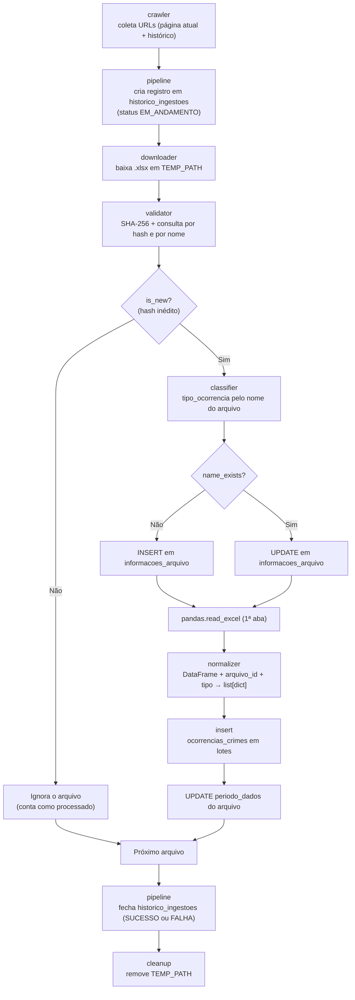

# Serviço de Ingestão de Dados

Documentação técnica do pipeline de ETL do **api_sspds**, responsável por coletar, validar, normalizar e carregar no banco as planilhas de estatísticas da SSPDS/CE.

- Código: pasta [`ingestion/`](../ingestion/)
- Visão geral do projeto: [`README.md`](../README.md)
- Modelo de dados e camada de acesso ao banco: [`docs/database.md`](database.md)

---

## 1. Visão geral do pipeline

O serviço de ingestão é o único componente que **escreve** os dados de ocorrências no banco (Supabase/PostgreSQL). Ele transforma planilhas `.xlsx` publicadas no portal da SSPDS/CE em registros estruturados na tabela `ocorrencias_crimes`, mantendo rastreabilidade do arquivo de origem e da execução que o trouxe.

### Fluxo de ponta a ponta



Resumo das etapas: **Extração** (crawler + downloader) → **Validação** (validator + classifier) → **Normalização** (normalizer) → **Carga** (insert).

---

## 2. Arquitetura e módulos do serviço

```text
ingestion/
├── classifier.py   # Classificação do tipo de ocorrência pelo nome do arquivo
├── cleanup.py      # Remoção da pasta temporária
├── config.py       # Leitura de variáveis de ambiente (get_variavel_ambiente)
├── crawler.py      # Coleta dos links das planilhas no portal da SSPDS/CE
├── downloader.py   # Download dos arquivos .xlsx
├── exception.py    # Hierarquia de exceções do serviço
├── helpers.py      # Funções auxiliares (recebeInteiro)
├── insert.py       # Inserções/atualizações nas tabelas do pipeline
├── normalizer.py   # Normalização das planilhas para o schema do banco
├── pipeline.py     # Orquestrador (ponto de entrada)
├── validator.py    # Hash SHA-256 e verificação de duplicidade
└── dockerfile      # Imagem Docker do serviço
```

Dependências externas ao pacote: `database/repository.py` (acesso ao Supabase) e `logging_system/logging_config.py` (logs). Ambos são copiados para a imagem Docker da ingestão.

### Resumo de entradas e saídas

| Módulo | Entrada | Saída |
| :-- | :-- | :-- |
| `crawler` | variáveis `url_sspds`, `url_sspds_historico`, `CRAWLER_TIMEOUT` | `list[str]` de URLs absolutas, sem duplicatas |
| `downloader` | URL de um `.xlsx` | `Path` relativo do arquivo salvo em `TEMP_PATH` |
| `validator` | caminho do `.xlsx` | `ValidatedFile` (`dict`) com hash, tamanho e flags de duplicidade |
| `classifier` | `ValidatedFile` | cópia do dict com `tipo_ocorrencia` |
| `insert` (arquivo) | `dict` de metadados | `arquivo_id` (`int`) |
| `normalizer` | `DataFrame`, `arquivo_id`, `tipo_ocorrencia` | `list[dict]` pronta para `ocorrencias_crimes` |
| `insert` (ocorrências) | `list[dict]` | — (insere em lotes) |
| `cleanup` | `TEMP_PATH` | — (remove a pasta) |

### 2.1 `config.py` e `helpers.py`

- `get_variavel_ambiente(nome) -> str`: carrega o `.env` (python-dotenv) e devolve o valor da variável. Lança `VariavelAmbienteNaoEncontrada` se ela não existir ou estiver vazia.
- `recebeInteiro(valor) -> int`: converte para inteiro; lança `ValorInteiroInvalido` em caso de `ValueError`/`TypeError`.

> [!NOTE]
> `CHUNK_SIZE` e `HASH_CHUNK_SIZE` são convertidos com `recebeInteiro(eval(...))` em `downloader.py` e `validator.py`, o que permite expressões como `1024 * 64` no `.env`. Como `eval` executa código arbitrário, **o `.env` deve ser tratado como arquivo confiável**. `TODO`: substituir por um parser seguro de expressões.

### 2.2 `crawler.py` — coleta dos links

Acessa duas páginas da SSPDS/CE e extrai os links das planilhas.

| Função                                               | Descrição                                                                                                                            |
| :--------------------------------------------------- | :----------------------------------------------------------------------------------------------------------------------------------- |
| `obter_conteudo_html(url, timeout) -> BeautifulSoup` | `requests.get` + `raise_for_status()`. Registra em log e **propaga** `Timeout`, `ConnectionError`, `HTTPError` e `RequestException`. |
| `extrair_links(conteudo_html) -> list`               | Devolve as tags `<a href>` de um elemento; lista vazia se o conteúdo for nulo/falso.                                                 |
| `normalizar_links(tags, url_base) -> list[str]`      | Converte `href` em URL absoluta (`urljoin`), ignora vazios e remove duplicatas preservando a ordem.                                  |
| `extrair_links_atuais(soup, url_base)`               | Usa o seletor CSS `#conteudo > div > div > div > section > section > div > div:nth-child(20)`.                                       |
| `extrair_links_historicos(soup, url_base)`           | Usa `div.wp-block-columns[style*="text-transform:uppercase"]` e, dentro dele, os links `a.wp-block-button__link[href]`.              |
| `crawler() -> list[str]`                             | Orquestra tudo: página atual → página histórica → `list(dict.fromkeys(atuais + históricos))`.                                        |

Comportamentos relevantes:

- `CRAWLER_TIMEOUT` ausente ou inválido não interrompe: usa 10 s e registra aviso.
- Se um seletor não encontrar o container, ou o container não tiver links, lança `EstruturaCSSDoSiteAlterado` — é o sinal de que o **layout do site mudou**.
- A ordem do resultado é: primeiro os arquivos atuais, depois os históricos.

### 2.3 `downloader.py` — download

`download_xlsx(url, destination_dir=TEMP_PATH, filename=None, timeout=DOWNLOADER_TIMEOUT) -> Path`

- **Validações:** URL `http`/`https` com host; nome do arquivo extraído do caminho da URL (o parâmetro `filename` só é usado se a URL não tiver nome); nome sem diretórios; extensão `.xlsx`; `timeout > 0`. Falhas geram `DownloadError`.
- **Gravação atômica:** baixa em blocos de `CHUNK_SIZE` para um arquivo temporário `.<nome>.xxxx.part` no mesmo diretório, faz `flush` + `fsync` e só então o renomeia (`replace`) para o nome final. O `.part` é removido no `finally`, evitando deixar planilhas incompletas.
- **Caminho de retorno:** relativo ao diretório de execução (`Path.cwd()`). `TEMP_PATH` deve, portanto, apontar para dentro do diretório de trabalho.
- **Exceções:** `DownloadTimeoutError`, `DownloadHTTPError`, `DownloadConnectionError`, `DownloadError` (outras falhas de requisição) e `FileWriteError` (disco).

### 2.4 `validator.py` — validação e duplicidade

| Função | Descrição |
| :-- | :-- |
| `calculate_sha256(file_path) -> str` | Hash SHA-256 lido em blocos de `HASH_CHUNK_SIZE`. Falha de leitura → `FileValidationError`. |
| `check_hash_in_database(file_hash) -> bool` | Consulta `informacoes_arquivo.hash_sha256`. Hash vazio ou falha de consulta → `DatabaseLookupError`. |
| `check_filename_in_database(file_name) -> list` | Consulta `informacoes_arquivo.nome_arquivo`. Retorna `[id, True]` ou `[None, False]`. |
| `validate_xlsx_file(file_path) -> ValidatedFile` | Verifica existência, se é arquivo regular e se a extensão é `.xlsx`; calcula o hash e consulta o banco por hash e por nome. |

`ValidatedFile`:

| Campo | Tipo | Significado |
| :-- | :-- | :-- |
| `path` | `str` | Caminho relativo (POSIX) do arquivo. |
| `name` | `str` | Nome do arquivo. |
| `sha256` | `str` | Hash do conteúdo. |
| `is_new` | `bool` | `True` quando o **hash** ainda não existe no banco. |
| `size_bytes` | `int` | Tamanho em bytes. |
| `name_exists` | `bool` | `True` quando já existe registro com esse **nome**. |
| `id_registro` | `int \| None` | `id` do registro encontrado **pelo nome** (não pelo hash). |

> [!IMPORTANT]
> `is_new` (conteúdo) e `name_exists` (nome) são verificações independentes. Um arquivo pode ter `is_new=True` e `name_exists=True`: é o caso de uma planilha **republicada com o mesmo nome e conteúdo atualizado**.

### 2.5 `classifier.py` — tipo de ocorrência

`classificar_arquivo(metadado) -> MetadadoArquivo` exige a chave `path`, chama `classificar_tipo_ocorrencia(nome)` e devolve **uma cópia** do dicionário com `tipo_ocorrencia` (o original não é alterado).

`classificar_tipo_ocorrencia(nome_arquivo)`:

1. Usa só o nome-base do arquivo e o normaliza (`normalizar_nome`: remove acentos, `casefold`, troca não alfanuméricos por espaço).
2. Compara com as palavras-chave de `REGRAS_TIPO_OCORRENCIA` (também normalizadas).
3. Deduplica as categorias encontradas.
4. Exige **exatamente uma** categoria: nenhuma ou mais de uma → `TipoOcorrenciaNaoIdentificado`. Nome vazio → `ValueError`.

| Categoria canônica (valor gravado em `tipo_crime`) | Palavras-chave (no nome do arquivo) |
| :-- | :-- |
| `CRIMES VIOLENTOS LETAIS E INTENCIONAIS - CVLI` | `cvli`, `crimes violentos letais e intencionais` |
| `APREENSÃO DE ARMAS DE FOGO` | `apreensao de armas de fogo`, `armas de fogo`, `arma de fogo`, `apreensao de armas` |
| `APREENSÃO DE ENTORPECENTES` | `apreensao de entorpecentes`, `entorpecentes`, `apreensao de drogas` |
| `HOMOFOBIA E TRANSFOBIA` | `homofobia e transfobia`, `homofobia`, `transfobia` |
| `CRIME OU PRECONCEITO DE RAÇA OU DE COR` | `crime ou preconceito de raca ou de cor`, `preconceito de raca`, `preconceito de cor` |
| `CRIMES SEXUAIS` | `crimes sexuais`, `crime sexual` |
| `INDÍGENAS VÍTIMAS DE CRIMES` | `indigenas vitimas de crimes`, `indigenas` |
| `LEI 11.340/06 (LEI MARIA DA PENHA)` | `lei maria da penha`, `lei 11 340 06`, `maria da penha` |
| `CRIME DE MAUS-TRATOS A ANIMAIS` | `maus tratos a animais`, `maus tratos animais`, `animais` |
| `CRIMES VIOLENTOS CONTRA O PATRIMÔNIO - CVP` | `crimes violentos contra o patrimonio`, `cvp` |
| `FURTO` | `furto`, `furtos` |
| `INCÊNDIO` | `incendio`, `incendios` |
| `BUSCA E SALVAMENTO` | `busca e salvamento`, `salvamento` |

> [!NOTE]
> Os valores canônicos precisam coincidir **exatamente** com os que `normalizer.py` espera. Ao adicionar uma categoria, atualize os dois módulos.

### 2.6 `normalizer.py` — normalização

`normalizer(df, arquivo_id, tipo_ocorrencia) -> list[dict]` roteia o DataFrame para o normalizador da categoria. Cada normalizador exige `arquivo_id > 0` (senão `ValueError`) e todas as colunas obrigatórias (senão `ColunasAusentesNaPlanilha`).

| Normalizador | Categorias atendidas | Colunas obrigatórias da planilha |
| :-- | :-- | :-- |
| `normalizar_cvli` | CVLI | Município, AIS, Natureza, Data, Hora, Dia da Semana, Meio Empregado, Gênero, Idade da Vítima, Escolaridade da Vítima, Raça da Vítima |
| `normalizar_animais_CVP_Furto_Incendio_Salvamento` | Maus-tratos a animais, CVP, Furto, Incêndio, Busca e Salvamento | Município, AIS, Data, Hora, Dia da Semana |
| `normalizar_armaDeFogo` | Apreensão de armas de fogo | Município, AIS, Data, Hora, Dia da Semana, Quantidade |
| `normalizar_preconceitoRacaOuCor_crimesSexuais_indigenas_leiMariaDaPenha` | Raça ou cor, Crimes sexuais, Indígenas, Lei Maria da Penha | Município, AIS, Data, Hora, Dia da Semana, Gênero, Idade da Vítima, Escolaridade da Vítima, Raça da Vítima |
| `normalizar_entorpecentes` | Apreensão de entorpecentes | Município, AIS, Data, Hora, Dia da Semana, Quantidade (Kg), Tipo de Entorpecente |
| `normalizar_homofobiaETransfobia` | Homofobia e Transfobia | Município, AIS, Data, Hora, Dia da Semana, Idade da Vítima, Escolaridade da Vítima, Raça da Vítima, Natureza, Identidade de Gênero, Orientação Sexual, Local |

Categoria não mapeada → `tipoOcorrenciaNaoEncontrado`. Erros de conversão (`ValueError`, `TypeError`, `OverflowError`), colunas ausentes e categoria não mapeada são **registrados em log e relançados** (`raise`): o `normalizer()` **não** devolve `None`; quem chama (o pipeline) recebe a exceção.

#### Funções de conversão

| Função | Regra |
| :-- | :-- |
| `normalizar_texto` | `NaN` → `None`; `str().strip().title()` e colapso de espaços; resultado vazio → `None`. |
| `normalizar_data` | `pandas.to_datetime(..., errors="raise").date()`; data inválida propaga erro. |
| `normalizar_hora` | `NaN` ou `"não informada"` → `None`; `datetime.time` é preservado; demais valores são convertidos com `pandas.to_datetime`. |
| `normalizar_idade` | `NaN`, `"não informada"` ou `"não informado"` → `None`; troca vírgula por ponto; devolve `float`. |
| `normalizar_quantidadeArmas` | `NaN`/`"não informada"` → `None`; valor fracionário → aviso em log e `None`; senão `int`. |
| `normalizar_quantidadeEntorpecente` | `NaN`/`"não informada"` → `None`; aceita vírgula decimal; falha de conversão → aviso e `None`; devolve `float`. |
| `normalizar_ais` | Aplica `normalizar_texto`; se contiver `"Ais Não Identificada"` → `None`. |

#### Registro produzido

Todos os normalizadores geram dicionários com as mesmas 20 chaves (as não aplicáveis ficam `None`), compatíveis com as colunas de `ocorrencias_crimes`:

`arquivo_id`, `tipo_crime`, `municipio`, `ais`, `data_fato`, `hora_fato`, `local_fato`, `dia_semana`, `natureza`, `meio_empregado`, `vitima_genero`, `vitima_idade`, `vitima_escolaridade`, `vitima_raca`, `vitima_orientacao_sexual`, `quantidade_armas`, `tipo_entorpecente`, `peso_entorpecente_kg`, `st_dia_semana_divergente`, `st_idade_invalida`.

- `data_fato` e `hora_fato` são gravadas como strings ISO (`YYYY-MM-DD`, `HH:MM:SS`).
- `municipio` é obrigatório: valor ausente gera `ValueError("Município ausente")`.

Campos preenchidos por grupo (os demais ficam `None`):

| Grupo | Campos específicos preenchidos |
| :-- | :-- |
| CVLI | `natureza`, `meio_empregado`, `vitima_genero`, `vitima_idade`, `vitima_escolaridade`, `vitima_raca` |
| Animais / CVP / Furto / Incêndio / Salvamento | apenas os campos comuns |
| Armas de fogo | `quantidade_armas` |
| Raça ou cor / Sexuais / Indígenas / Maria da Penha | `vitima_genero`, `vitima_idade`, `vitima_escolaridade`, `vitima_raca` |
| Entorpecentes | `tipo_entorpecente`, `peso_entorpecente_kg` |
| Homofobia e Transfobia | `local_fato`, `natureza`, `vitima_genero` (←`Identidade de Gênero`), `vitima_idade`, `vitima_escolaridade`, `vitima_raca`, `vitima_orientacao_sexual` |

Campos comuns: `arquivo_id`, `tipo_crime`, `municipio`, `ais`, `data_fato`, `hora_fato`, `dia_semana` e as duas flags de qualidade.

### 2.7 `insert.py` — carga

Camada fina sobre `database.repository`. Cada função cria um cliente Supabase se nenhum for informado.

| Função | Efeito |
| :-- | :-- |
| `inserir_historico_ingestoes(dados, cliente)` | Insere em `historico_ingestoes`; retorna o `id`. |
| `atualizar_historico_ingestoes(id, dados, cliente)` | Atualiza `historico_ingestoes` pelo `id`. |
| `inserir_informacoes_arquivo(dados, cliente)` | Insere em `informacoes_arquivo`; retorna o `id` (usado como `arquivo_id`). |
| `atualizar_informacoes_arquivo(id, dados, cliente)` | Atualiza `informacoes_arquivo`; retorna o `id`. |
| `inserir_ocorrencias_crimes(dados, tamanho_lote, cliente)` | Divide em lotes de `INSERT_CHUNK_SIZE` e insere em `ocorrencias_crimes`. |

### 2.8 `cleanup.py`

`limpar_pasta_temporaria(caminho=TEMP_PATH)`: remove a pasta e o conteúdo com `shutil.rmtree`. Pasta inexistente → apenas log; caminho que não é pasta → `NotADirectoryError`; falha de remoção → log e `OSError`.

### 2.9 `pipeline.py` — orquestrador

`pipeline() -> None` (sem parâmetros). Passo a passo:

1. `crawler()` obtém a lista de URLs e cria o cliente Supabase.
2. Insere em `historico_ingestoes` o registro `{status: "EM_ANDAMENTO", qtd_arquivos_encontrados}`.
3. Para cada URL, dentro de um `try/except Exception`:
   1. `download_xlsx(url)` e registro de `data_coleta` (UTC).
   2. `validate_xlsx_file(...)`.
   3. Se `is_new` for `False`, nada mais é feito para o arquivo.
   4. Se `is_new` for `True`: `classificar_arquivo(...)` e então
      - `name_exists=True` → `atualizar_informacoes_arquivo` (atualiza `url_download`, `hash_sha256`, `periodo_dados=None`, `tamanho_bytes`, `data_coleta`, `atualizado_em`, `ingestao_id`; **não** altera `nome_arquivo` nem `tipo_crime`);
      - `name_exists=False` → `inserir_informacoes_arquivo` (`nome_arquivo`, `url_download`, `hash_sha256`, `tipo_crime`, `periodo_dados=None`, `tamanho_bytes`, `data_coleta`, `ingestao_id`).
   5. `pandas.read_excel(path)` — lê a **primeira aba** da planilha.
   6. `normalizer(df, arquivo_id, tipo_ocorrencia)` → `inserir_ocorrencias_crimes(...)`.
   7. Calcula o menor e o maior ano de `data_fato` e atualiza `periodo_dados` (`"2024"` ou `"2019 - 2024"`).
   8. Incrementa `arquivos_processados`.
4. Qualquer exceção no passo 3 é registrada com `logger.exception`, incrementa `arquivos_falhas` e o laço segue para o próximo arquivo.
5. Atualiza `historico_ingestoes` com `data_fim`, `status` (`SUCESSO` se não houve falhas; `FALHA` se houve ao menos uma) e os contadores.
6. Chama `limpar_pasta_temporaria()`.

---

## 3. Fonte dos dados e regras de negócio

### 3.1 Como os arquivos são obtidos

| Item | Detalhe |
| :-- | :-- |
| Fonte | Portal de estatísticas da SSPDS/CE (`url_sspds`) e página de dados detalhados/históricos (`url_sspds_historico`). |
| Método | Raspagem HTML (`requests` + `BeautifulSoup`, parser `html.parser`) para descobrir os links; download direto de cada link. |
| Formato aceito | Somente `.xlsx` (o downloader e o validador rejeitam outras extensões). |
| Leitura | `pandas.read_excel` (engine OpenPyXL), primeira aba. |
| Periodicidade | A SSPDS publica mensalmente; a ingestão deve ser executada sob demanda ou agendada externamente (o projeto não inclui agendador). |

Cada planilha traz uma categoria de ocorrência; os cabeçalhos esperados estão na [tabela do normalizador](#26-normalizerpy--normalização).

### 3.2 Validações que rejeitam dados fora do padrão

| Etapa | Condição rejeitada | Exceção |
| :-- | :-- | :-- |
| Download | URL não `http(s)`, sem host, sem nome de arquivo ou que não termine em `.xlsx` | `DownloadError` |
| Download | Timeout, erro HTTP, falha de conexão, falha ao gravar | `DownloadTimeoutError`, `DownloadHTTPError`, `DownloadConnectionError`, `FileWriteError` |
| Validação | Arquivo inexistente, que não é arquivo regular ou sem extensão `.xlsx` | `FileValidationError` |
| Classificação | Nome sem categoria reconhecida, ou com mais de uma | `TipoOcorrenciaNaoIdentificado` |
| Normalização | Colunas obrigatórias ausentes | `ColunasAusentesNaPlanilha` |
| Normalização | `arquivo_id <= 0`, município ausente, data inválida, hora inválida | `ValueError` (ou erro de conversão do pandas) |
| Normalização | Categoria não mapeada | `tipoOcorrenciaNaoEncontrado` |

Em todos os casos o arquivo é contado como falha, mas a execução continua com os demais arquivos.

### 3.3 Sinalização de inconsistências da fonte (sem correção silenciosa)

| Flag | Regra |
| :-- | :-- |
| `st_dia_semana_divergente` | Compara `Dia da Semana` com o dia calculado a partir de `Data` (ignora maiúsculas/minúsculas e o sufixo `-feira`). `True` se divergir, com aviso em log. O valor informado pela fonte é **preservado** em `dia_semana`. Se a fonte não informar o dia, a flag fica `False`. |
| `st_idade_invalida` | Disponível nos grupos com idade da vítima. `True` quando a idade não é inteira ou está fora de 0–130. Idade ausente/"não informada" vira `None` com flag `False`. |

Atenção ao armazenamento da idade: quando a idade não é `None`, ela é convertida com `int(...)` **mesmo se inválida** — uma idade fracionária é truncada e uma fora do intervalo é mantida; a flag `st_idade_invalida` é o que indica o problema.

Outras regras de limpeza:

- Textos recebem `strip`, colapso de espaços e *Title Case* (`"HOMICÍDIO"` → `"Homicídio"`).
- `"AIS Não Identificada (...)"` vira `ais = None` (o município já é gravado em coluna própria).
- Quantidades de armas fracionárias e quantidades de entorpecentes não numéricas viram `None`, com aviso.
- Vírgula decimal (`"1,25"`) é aceita em idade e quantidades.

### 3.4 Como a duplicidade de carga é evitada

A deduplicação é feita **por arquivo**, antes de qualquer normalização:

| `is_new` (hash) | `name_exists` (nome) | O que acontece |
| :-- | :-- | :-- |
| `False` | qualquer | Conteúdo já ingerido: o arquivo é ignorado (não classifica, não normaliza, não insere). |
| `True` | `False` | Arquivo inédito: insere em `informacoes_arquivo` e carrega as ocorrências. |
| `True` | `True` | Mesmo nome, conteúdo novo: atualiza o registro em `informacoes_arquivo` (reaproveitando o `id`) e carrega as ocorrências. |

Reforço no banco: `informacoes_arquivo.hash_sha256` é `UNIQUE` (veja [`database.md`](database.md)).

### 3.4.1 Limitações conhecidas do comportamento atual

> [!WARNING]
> Pontos observados no código que afetam a idempotência e a observabilidade. Não são corrigidos pela documentação.

1. **Sem transação por arquivo.** O registro em `informacoes_arquivo` (com o hash) é gravado **antes** da normalização e da carga. Se a normalização ou uma inserção em lote falhar depois disso, o hash já está no banco: na execução seguinte o arquivo será tratado como já ingerido (`is_new=False`) mesmo sem ter ocorrências completas.
2. **Reprocessamento por nome não remove ocorrências antigas.** No caso `is_new=True` + `name_exists=True`, as linhas antigas ligadas àquele `arquivo_id` permanecem e as novas são inseridas junto, podendo gerar registros duplicados.
3. **`arquivos_processados` inclui arquivos ignorados** (`is_new=False`), pois o contador é incrementado fora do `if`.
4. **Limpeza fora de `finally`.** Falhas do crawler ou da atualização final do histórico interrompem a execução sem remover `TEMP_PATH`.
5. **`historico_ingestoes.mensagem_erro` não é preenchida.** O traceback é apenas enviado ao log.
6. **Status binário.** Basta uma falha para o histórico ficar `FALHA`, mesmo que os demais arquivos tenham sido carregados; e o processo termina com código de saída `0` nesse caso (apenas falhas fora do laço, como no crawler, encerram com erro).
7. **Sem cache HTTP.** Como `TEMP_PATH` é apagado ao final, todas as planilhas são baixadas novamente a cada execução.

`TODO`: avaliar tratamento transacional, preenchimento de `mensagem_erro` e status parcial.

---

## 4. Execução e operação

### 4.1 Pré-requisitos

- `.env` preenchido (veja a tabela completa de variáveis no [`README.md`](../README.md#5-pré-requisitos-e-configuração-do-ambiente)).
- Para a ingestão: `url_sspds`, `url_sspds_historico`, `DOWNLOADER_TIMEOUT`, `TEMP_PATH`, `CHUNK_SIZE`, `HASH_CHUNK_SIZE`, `INSERT_CHUNK_SIZE`, `LOG_LEVEL`, `SUPABASE_URL`, `SUPABASE_KEY` (e, opcionalmente, `CRAWLER_TIMEOUT`).
- Schema do banco criado (DDL em [`database.md`](database.md#6-script-ddl-completo-reprodução-do-schema)).

### 4.2 Executando

**Localmente** (a partir da raiz do repositório, com o ambiente virtual ativo):

```bash
python -m ingestion.pipeline
```

> Use `-m`: o pacote usa imports relativos, então `python ingestion/pipeline.py` não funciona.

**Via Docker Compose:**

```bash
docker compose build ingestion
docker compose up ingestion          # ou: docker compose run --rm ingestion
```

O container executa `python -m ingestion.pipeline` e encerra ao terminar. O `compose.yml` monta `./ingestion` em `/workspace/ingestion` e injeta o `.env`.

### 4.3 Parâmetros

O pipeline **não aceita argumentos de linha de comando**: não há filtros por ano, categoria ou reprocessamento forçado. Todo o comportamento é controlado por variáveis de ambiente (`url_sspds`, `url_sspds_historico`, timeouts, tamanhos de bloco e de lote). `TODO`: avaliar uma CLI com filtros.

### 4.4 Reprocessar um arquivo

Como a duplicidade é decidida pelo hash, não há *flag* de reprocessamento. Pelo schema, `ocorrencias_crimes.arquivo_id` tem `ON DELETE CASCADE`: remover o registro do arquivo em `informacoes_arquivo` remove também suas ocorrências, e a próxima execução o tratará como inédito.

```sql
-- CUIDADO: apaga o arquivo e, em cascata, todas as suas ocorrências.
DELETE FROM public.informacoes_arquivo WHERE nome_arquivo = '<nome-do-arquivo>.xlsx';
```

### 4.5 Acompanhando uma execução

- **Banco:** a tabela `historico_ingestoes` guarda `data_inicio`, `data_fim`, `status` (`EM_ANDAMENTO`, `SUCESSO`, `FALHA`), `qtd_arquivos_encontrados`, `qtd_arquivos_processados` e `qtd_arquivos_falhas`.
- **Logs:** saída padrão do processo/container (formato descrito na seção 5).
- **Metadados por arquivo:** `informacoes_arquivo` (nome, URL, hash, tipo, período, tamanho, datas e `ingestao_id`).

---

## 5. Tratamento de erros, logs e testes

### 5.1 Hierarquia de exceções (`exception.py`)

```text
Exception
├── IngestionError
│   ├── VariavelAmbienteNaoEncontrada
│   ├── EstruturaCSSDoSiteAlterado        # layout do site mudou
│   ├── ValorInteiroInvalido
│   ├── NormalizerError
│   │   ├── ColunasAusentesNaPlanilha     # schema da planilha mudou
│   │   └── tipoOcorrenciaNaoEncontrado
│   ├── DownloadError
│   │   ├── DownloadHTTPError
│   │   ├── DownloadTimeoutError
│   │   ├── DownloadConnectionError
│   │   └── FileWriteError
│   ├── FileValidationError
│   └── DatabaseLookupError
└── ValueError
    └── TipoOcorrenciaNaoIdentificado     # não herda de IngestionError
```

Falhas de banco vindas de `database/` (`ErroOperacaoBanco`, `ErroConexaoBanco`) não fazem parte desta hierarquia; em `validator.py` consultas que falham são encapsuladas em `DatabaseLookupError`.

### 5.2 Como cada tipo de falha é tratado

| Situação | Onde ocorre | Resultado |
| :-- | :-- | :-- |
| Falha de rede ao listar a página (timeout, conexão, HTTP) | `crawler` | Log de erro e exceção propagada. Não há arquivos a processar; a execução **aborta** e o histórico não é criado. |
| Alteração de layout do site | `crawler` | `EstruturaCSSDoSiteAlterado` (log + propagação). Aborta a execução. Corrigir os seletores em `extrair_links_atuais` / `extrair_links_historicos`. |
| Falha de rede ao baixar uma planilha | `downloader` | Exceção específica; o arquivo conta como falha e o pipeline segue. |
| Planilha corrompida/ilegível | `validator` / `pandas` | Exceção capturada no laço; conta como falha. |
| Erro de schema (colunas ausentes, tipo desconhecido) | `normalizer` | Log da falha, exceção relançada, falha contabilizada. |
| Erro de banco | `database.repository` / `insert` | `ErroOperacaoBanco` ou `DatabaseLookupError`; falha contabilizada. |
| Variável de ambiente ausente | import dos módulos | `VariavelAmbienteNaoEncontrada` antes de qualquer processamento. |

### 5.3 Logs

Configurados por `logging_system/logging_config.py` (`configure_logging()`):

Exemplo ilustrativo (os números variam a cada execução):

```text
2026-11-12T10:30:00 | INFO | ingestion.crawler | Crawler concluído: 14 links atuais, 90 históricos e 100 únicos no total.
```

- Formato: `%(asctime)s | %(levelname)s | %(name)s | %(message)s`, data `%Y-%m-%dT%H:%M:%S`.
- Nível definido por `LOG_LEVEL` (`INFO` se o valor não for um nível válido).
- Falhas por arquivo são registradas com traceback (`logger.exception`).

### 5.4 Testes

Os testes do módulo ficam em [`tests/test_ingestion.py`](../tests/test_ingestion.py), com fixtures em [`tests/conftest.py`](../tests/conftest.py) (HTML sintético das páginas atual e histórica, DataFrames de exemplo por categoria). Usam `monkeypatch`/`unittest.mock`, portanto **não acessam a rede nem o banco**.

```bash
# Com o ambiente virtual ativo e o .env preenchido (as configurações são lidas no import)
python -m pytest tests/test_ingestion.py

# Um teste ou grupo específico
python -m pytest tests/test_ingestion.py -k "normalizar_cvli"
python -m pytest tests/test_ingestion.py -k "crawler"
```

Cobertura atual do módulo:

| Componente                                    | Coberto por testes                                                                                                                                                                                                                                                                                                                       |
| :-------------------------------------------- | :--------------------------------------------------------------------------------------------------------------------------------------------------------------------------------------------------------------------------------------------------------------------------------------------------------------------------------------- |
| `crawler`                                     | Sim — extração atual/histórica, deduplicação, erros HTTP/rede, estrutura ausente, timeout inválido                                                                                                                                                                                                                                       |
| `helpers`                                     | Sim                                                                                                                                                                                                                                                                                                                                      |
| `normalizer`                                  | Sim — conversões, cada grupo de normalização, colunas ausentes, `arquivo_id` inválido, município vazio, divergência de dia da semana                                                                                                                                                                                                     |
| `classifier`                                  | Sim — categorias, nome vazio, categoria desconhecida/ambígua, metadados inválidos                                                                                                                                                                                                                                                        |
| `validator`                                   | Sim — hash, consulta por hash e nome, extensão e arquivo inválidos, erros do banco                                                                                                                                                                                                                                                       |
| `downloader`, `insert`, `cleanup`, `pipeline` | Sem testes dedicados: são módulos de orquestração e de apoio, sem regra de transformação própria. O `downloader` apenas baixa arquivos, o `insert` delega para funções de `database/repository.py` (cobertas em `tests/test_database.py`), o `cleanup` apenas apaga a pasta temporária e o `pipeline` apenas encadeia as demais funções. |

Os testes de integração com o Supabase real estão em `tests/test_database.py` (marcador `database`) e fazem parte da documentação do banco; para excluí-los: `python -m pytest -m "not database"`.

### 5.5 Erro de certificado SSL (`CERTIFICATE_VERIFY_FAILED`)

**Problema.** Ao acessar o portal de estatísticas da SSPDS (`www.ce.gov.br`) por HTTPS, o servidor envia o certificado do domínio (`*.ce.gov.br`), mas **não envia o certificado intermediário Amazon RSA 2048 M01**. Clientes que não buscam o intermediário sozinhos, como o Python com `requests` em Linux/Docker, não conseguem validar a cadeia e falham com `CERTIFICATE_VERIFY_FAILED`. Navegadores e o Windows funcionam porque obtêm o intermediário automaticamente pelo mecanismo AIA (*Authority Information Access*).

**Solução adotada.**

1. O certificado intermediário Amazon RSA 2048 M01 foi obtido, convertido para `.crt` e validado pela impressão digital SHA-256.
2. Foi incluído no repositório (`certs/amazon-rsa-2048-m01.crt`; há também a versão `.der`).
3. O `ingestion/dockerfile` o copia para `/usr/local/share/ca-certificates/` e executa `update-ca-certificates`.
4. `REQUESTS_CA_BUNDLE=/etc/ssl/certs/ca-certificates.crt` indica ao `requests` o conjunto de certificados do sistema.

Assim o crawler faz requisições HTTPS **sem desabilitar a validação** (`verify=False`), preservando a verificação dos certificados.

> [!NOTE]
> A solução depende do intermediário usado pelo servidor. Se o portal alterar sua cadeia de certificados, o arquivo em `certs/` precisará ser atualizado.

> [!TIP]
> A configuração acima vale para a imagem Docker da ingestão. Ao rodar localmente em Linux, o mesmo erro pode ocorrer; no Windows, o problema não aparece.

---

## 6. Variáveis de ambiente do serviço

| Variável | Uso no módulo | Obrigatória |
| :-- | :-- | :-- |
| `url_sspds` | URL da página de estatísticas atuais (`crawler`). | Sim |
| `url_sspds_historico` | URL da página histórica (`crawler`). | Sim |
| `CRAWLER_TIMEOUT` | Timeout do crawler; padrão 10 s se ausente ou inválida. | Não |
| `DOWNLOADER_TIMEOUT` | Timeout do download (`downloader`). | Sim |
| `TEMP_PATH` | Pasta temporária de downloads (`downloader`, `validator`, `cleanup`). | Sim |
| `CHUNK_SIZE` | Bloco de download; aceita expressão (`eval`). | Sim |
| `HASH_CHUNK_SIZE` | Bloco de leitura do SHA-256; aceita expressão (`eval`). | Sim |
| `INSERT_CHUNK_SIZE` | Registros por lote (`insert`). | Sim |
| `LOG_LEVEL` | Nível de log (`logging_system`). | Sim |
| `SUPABASE_URL` / `SUPABASE_KEY` | Conexão com o banco (`database`). | Sim |

Valores de exemplo e demais detalhes: [`.env.example`](../.env.example) e [`README.md`](../README.md#5-pré-requisitos-e-configuração-do-ambiente).

---

## 7. Imagem Docker (`ingestion/dockerfile`)

- Base `python:3.13.4`, diretório de trabalho `/workspace`.
- Instala as dependências de `requirements.txt` e o pacote `ca-certificates`.
- Copia `certs/amazon-rsa-2048-m01.crt` para `/usr/local/share/ca-certificates/`, executa `update-ca-certificates` e define `REQUESTS_CA_BUNDLE=/etc/ssl/certs/ca-certificates.crt`. O motivo está na [seção 5.5](#55-erro-de-certificado-ssl-certificate_verify_failed): o portal não envia o certificado intermediário Amazon RSA 2048 M01.
- Copia `ingestion/`, `database/` e `logging_system/`.
- Comando padrão: `python -m ingestion.pipeline`.
- O `.env` **não** é copiado para a imagem: é injetado pelo `env_file` do `compose.yml`.
